# Causal Uplift for Activation & Retention — Hệ thống Quyết định Giữ chân & Kích hoạt Khách hàng Dựa trên Suy luận Nhân quả

[](pyproject.toml)
[](src/telco_churn/api.py)
[-2a78d6)](reports/v4/EVIDENCE_INDEX.md)
[](reports/v4/challenge_suite.json)
[-16654e)](reports/v4/ai_assistant/EVALUATION_REPORT.md)

> **Retention Decision Lab** là một hệ thống kỹ thuật máy học, suy luận nhân quả (Causal Uplift Modeling), tối ưu hóa chính sách dưới ràng buộc ngân sách và giải thích AI có kiểm chứng (Grounded AI Explainability) cho bài toán **Kích hoạt (Activation)** và **Giữ chân khách hàng (Retention)**. Dự án tách biệt nghiêm ngặt giữa **dự báo rủi ro quan sát**, **ước lượng tác động nhân quả từ thử nghiệm ngẫu nhiên**, và **giả định kinh tế kịch bản**, đồng thời trang bị cho hệ thống quyền từ chối triển khai (`NO_LAUNCH`) khi bằng chứng thống kê chưa đạt ngưỡng an toàn.

---

## Mục lục

1. [Giới thiệu Dự án & Bài toán Cốt lõi](#1-giới-thiệu-dự-án--bài-toán-cốt-lõi)
2. [Kiến trúc Hệ thống & Phương pháp Kỹ thuật](#2-kiến-trúc-hệ-thống--phương-pháp-kỹ-thuật)
3. [Kết quả Thực nghiệm Đạt được](#3-kết-quả-thực-nghiệm-đạt-được)
4. [Hai Giao diện Tương tác & Hệ thống AI Giải thích](#4-hai-giao-diện-tương-tác--hệ-thống-ai-giải-thích)
5. [Cấu trúc Mã nguồn & Bản đồ Bằng chứng](#5-cấu-trúc-mã-nguồn--bản-đồ-bằng-chứng)
6. [Hướng dẫn Cài đặt, Khởi chạy & Kiểm chứng](#6-hướng-dẫn-cài-đặt-khởi-chạy--kiểm-chứng)

---

## 1. Giới thiệu Dự án & Bài toán Cốt lõi

### 1.1. Tại sao dự báo rủi ro rời bỏ $\mathbb{P}(Y=1\mid X)$ là chưa đủ?

Trong phần lớn hệ thống CRM viễn thông và bán lẻ truyền thống, chiến dịch giữ chân khách hàng được vận hành bằng cách huấn luyện một mô hình phân loại rủi ro rời bỏ $\hat{r}(x) = \mathbb{P}(Y(0)=1 \mid X=x)$ rồi gửi ưu đãi cho nhóm có điểm rủi ro cao nhất. Cách tiếp cận này mắc phải **ba sai lầm nền tảng về mặt nhân quả và kinh tế**:

1. **Nhầm lẫn giữa Rủi ro cơ sở (Baseline Risk) và Độ nhạy can thiệp (Causal Uplift):** Một khách hàng có xác suất rời bỏ 85% có thể đã quyết định chấm dứt hợp đồng bất chấp ưu đãi (*Lost Cause*), trong khi một khách hàng có rủi ro trung bình có thể phản hồi rất tích cực với gói nâng cấp dịch vụ (*Persuadable*).
2. **Kích hoạt hiệu ứng ngược ("Sleeping Dogs"):** Trên dữ liệu chuỗi thời gian có hiệu ứng trôi dạt hành vi (Temporal Drift), việc liên hệ hoặc gửi ưu đãi cho khách hàng đang yên ổn có thể nhắc họ kiểm tra lại hóa đơn và hủy dịch vụ sớm hơn ($\tau(x) < 0$). Trong phòng thí nghiệm cơ chế thời gian của dự án ([`temporal_lab.py`](file:///d:/GitHub/machine/src/telco_churn/temporal_lab.py)), chính sách nhắm mục tiêu thuần theo rủi ro (`risk_hgb`) đã gửi ưu đãi nhầm vào **40,5% khách hàng chịu tác động tiêu cực**, làm phát sinh giá trị ròng **âm `-2.813` đơn vị**.
3. **Đảo dấu đa cộng tuyến trên dữ liệu quan sát (Collinearity Sign Reversal):** Khi không có biến phân bổ can thiệp ngẫu nhiên $W \in \{0,1\}$, việc dùng mô hình rủi ro quan sát để mô phỏng "giảm giá cước" sẽ bị sai lệch nặng do tương quan ẩn giữa gói dịch vụ và mức cước.

### 1.2. Công thức hóa Bài toán Quyết định Nhân quả Dưới Ràng buộc Ngân sách

Với mỗi khách hàng $i$ có vector đặc trưng trước can thiệp $X_i \in \mathcal{X}$, biến hành động $W_i \in \{0, 1\}$ (không liên hệ vs. gửi ưu đãi/kích hoạt) và kết quả tiềm năng $Y_i(1), Y_i(0)$, **tác động điều trị trung bình có điều kiện (CATE / Uplift)** được định nghĩa là:

$$\tau(x) = \mathbb{E}\big[Y_{\text{retain}}(1) - Y_{\text{retain}}(0) \;\big|\; X = x\big] = \mathbb{E}\big[Y_{\text{churn}}(0) - Y_{\text{churn}}(1) \;\big|\; X = x\big]$$

Khi mỗi khách hàng có biên lợi nhuận kỳ vọng $m_i$ và chi phí liên hệ/ưu đãi $c_i$, bài toán tìm chính sách phân bổ tối ưu $\pi: \mathcal{X} \to \{0, 1\}$ dưới trần dung lượng $K = \lfloor b \cdot n \rfloor$, trần ngân sách tiền tệ $B$, điều kiện hợp lệ $E_i \in \{0,1\}$ và thời gian nghỉ liên hệ (cooldown) $D_i \ge d_{\min}$ là một bài toán quy hoạch nguyên 0-1:

$$\max_{\pi \in \{0,1\}^n} \sum_{i=1}^n \pi(X_i) \cdot \big(m_i \cdot \hat{\tau}(X_i) - c_i\big) \quad \text{s.t.} \quad \sum_{i=1}^n \pi(X_i) \le K, \quad \sum_{i=1}^n c_i \pi(X_i) \le B, \quad \pi(X_i) \le E_i \cdot \mathbb{I}(D_i \ge d_{\min})$$

### 1.3. Bốn Ma trận Phân nhóm Khách hàng (Activation & Retention Archetypes)

| Phân nhóm (Archetype) | Rủi ro Cơ sở $\mathbb{P}(Y(0)=1\mid X)$ | Tác động Nhân quả $\tau(X)$ | Hành động Tối ưu |
|---|---|---|---|
| **Persuadables (Ứng viên thuyết phục)** | Trung bình – Cao | Dương rõ rệt ($\tau(x) > c / m$) | **Ưu tiên phân bổ ngân sách** (Nâng cấp hợp đồng, kích hoạt gói TechSupport/Security) |
| **Sure Things (Nhóm an toàn)** | Thấp | Xấp xỉ $0$ | **Không gửi ưu đãi tốn phí** (Tránh lãng phí ngân sách vào người vốn dĩ sẽ ở lại) |
| **Lost Causes (Nhóm không thể cứu vãn)** | Rất cao | Xấp xỉ $0$ hoặc dưới điểm hòa vốn | **Bỏ qua ưu đãi tài chính** (Tập trung cải thiện chất lượng dịch vụ gốc) |
| **Sleeping Dogs (Nhóm phản tác dụng)** | Thấp – Trung bình | Âm ($\tau(x) < 0$) | **Tuyệt đối không làm phiền (Do Not Disturb)** để tránh kích hoạt rời bỏ |

---

## 2. Kiến trúc Hệ thống & Phương pháp Kỹ thuật

### 2.1. Sơ đồ Kiến trúc Tổng thể

```mermaid
flowchart TD
    subgraph Data["1. Tầng Dữ liệu Đa miền & Kiểm định Hợp đồng (Contracts QG0)"]
        D1["IBM Telco Churn<br/>(7.043 KH · Quan sát tĩnh)"]
        D2["Orange Belgium Uplift<br/>(11.896 KH · Can thiệp thực tế)"]
        D3["Hillstrom Email Benchmark<br/>(64.000 KH · RCT 3 nhánh)"]
        D4["Lenta Retail SMS<br/>(687.029 KH / 60k Dev · RCT)"]
        D5["Synthetic Temporal Drift Lab<br/>(80.157 dòng · 12 tháng)"]
    end

    subgraph Models["2. Tầng Mô hình hóa Rủi ro & Suy luận Nhân quả"]
        M_Risk["Pipeline Dự báo Rủi ro Leak-Free<br/>Logistic L2 (Champion) vs HGB vs CatBoost"]
        M_Uplift["8 Recipes Causal Uplift (M01–M08)<br/>Control-Rank · S/T/X/R-Learner · Doubly Robust DR"]
        M_Eval["Đánh giá Chính sách Doubly Robust (AIPW)<br/>Kiểm định độ phủ R00/R01/R1 & Cận McDiarmid"]
    end

    subgraph Policy["3. Tầng Chính sách, Phân bổ Ngân sách & Kiểm định Giả mạo"]
        P_Alloc["Tối ưu hóa Ngân sách (R4/R4b)<br/>0-1 Knapsack vs Greedy Rank · Cooldown · Eligibility"]
        P_Gates["11 Cổng Kiểm định Khoa học (QG0–QG7)<br/>24 Ca Đột biến · Kiểm định Hoán vị e(X) · Quyền NO_LAUNCH"]
        P_Replay["Gói Bằng chứng Tái lập SHA-256<br/>telco-replay (v1 & v2 deterministic parity)"]
    end

    subgraph AILab["4. Tầng AI Giải thích & Giao diện Tương tác"]
        AI_Exp["Giải thích AI Cấp độ Khách hàng<br/>Log-Odds tuyến tính · ΔP biên · Kịch bản What-If<br/>(Loại trừ gender & SeniorCitizen)"]
        AI_Copilot["Trợ lý Bằng chứng AI X09<br/>Trích dẫn SHA-256 · 0% Overclaim Guardrail"]
        UI_Planner["Campaign Planner UI (:8000/planner/)<br/>Biểu đồ Frontier · AI Inspector · Song ngữ EN/VI"]
        UI_Console["Research Decision Console (:8050)<br/>Giám sát Cổng · Cross-Domain Uplift · R1 Repair"]
    end

    Data --> Models --> Policy --> AILab
```



### 2.2. Nhánh 1: Pipeline Dự báo Rủi ro Không rò rỉ (Leak-Free Risk Pipeline) & Cổng Độ phức tạp

Trong [`src/telco_churn/train.py`](file:///d:/GitHub/machine/src/telco_churn/train.py) và [`src/telco_churn/model_tournament.py`](file:///d:/GitHub/machine/src/telco_churn/model_tournament.py):
- **Tiền xử lý chống rò rỉ (Leak-Free Preprocessing):** Mọi phép biến đổi (`SimpleImputer`, `StandardScaler`, `OneHotEncoder`) đều nằm bên trong `scikit-learn Pipeline` và chỉ được khớp (`fit`) trên tập huấn luyện trong từng fold của `5-fold StratifiedKFold` trên sơ đồ chia tách cố định `60% Train / 20% Validation / 20% Test`.
- **Cổng độ phức tạp (Complexity Gate):** Một mô hình phi tuyến phức tạp (`CatBoost` hoặc `HistGradientBoosting`) chỉ được phép thay thế mô hình tuyến tính `LogisticRegression` làm Champion nếu cải thiện PR-AUC trên tập kiểm định ít nhất **`+0.010`**. Trên thực tế, `CatBoost` chỉ vượt `LogisticRegression` **`+0.0088`** trên tập validation (`0.6401` vs. `0.6313`), do đó hệ thống tự động giữ `LogisticRegression` làm Champion (`artifacts/models/champion.joblib`) để đảm bảo tính minh bạch, tốc độ suy luận `~3.2 ms` và khả năng giải thích chính xác.
- **Chứng minh Toán học về Đảo dấu Đa cộng tuyến (Collinearity Sign Reversal):**
  Trích xuất trực tiếp vector trọng số $\beta$ từ `champion.joblib` cho thấy:
  - `numeric__tenure` $= -1.5091$ (Thời gian gắn bó càng lâu, rủi ro rời bỏ càng giảm)
  - `categorical__InternetService_Fiber optic` $= +1.1453$ (Gói cáp quang có rủi ro rời bỏ cao)
  - `numeric__TotalCharges` $= +0.7713$
  - `numeric__MonthlyCharges` $= -1.7973$
  Vì `MonthlyCharges` cộng tuyến mạnh với `Fiber optic` và `TotalCharges`, hệ số riêng phần của `MonthlyCharges` mang dấu âm khi giữ cố định chỉ báo `Fiber optic`. Hệ quả là nếu dùng mô hình rủi ro quan sát $\mathbb{P}(Y\mid X)$ để mô phỏng giảm giá cước hàng tháng (`MonthlyCharges` $\downarrow$), xác suất rủi ro dự báo sẽ tăng giả tạo. Phát hiện này chứng minh bằng toán học ngay trên mã nguồn vì sao **không thể dùng mô hình rủi ro quan sát để định giá ưu đãi mà bắt buộc phải dùng mô hình suy luận nhân quả trên dữ liệu thử nghiệm ngẫu nhiên**.

### 2.3. Nhánh 2: Hệ thống 8 Mô hình Causal Uplift (`M01`–`M08`) & Đánh giá Chính sách Doubly Robust

Trong [`src/telco_churn/candidates.py`](file:///d:/GitHub/machine/src/telco_churn/candidates.py), [`src/telco_churn/uplift.py`](file:///d:/GitHub/machine/src/telco_churn/uplift.py) và [`src/telco_churn/policy_comparison.py`](file:///d:/GitHub/machine/src/telco_churn/policy_comparison.py), dự án triển khai đầy đủ 8 phương pháp xếp hạng chính sách nhân quả:

| Mã | Tên Phương pháp | Cơ chế Toán học & Mô hình Cơ sở |
|---|---|---|
| `M01` | **Control-Outcome Ranking** | Huấn luyện $\hat{\mu}_0(X) = \mathbb{P}(Y=1\mid X, W=0)$ bằng Logistic L2 trên nhóm đối chứng; xếp hạng khách hàng theo rủi ro/phản hồi cơ sở không cần ước lượng hiệu số hai nhánh. |
| `M02` | **Separate Arm Control Score** | Độc lập hóa hoàn toàn đặc trưng giữa hai nhánh và chấm điểm cơ sở bằng bộ ước lượng tuyến tính có điều chuẩn. |
| `M03` | **S-Learner (HGB)** | Huấn luyện một mô hình `HistGradientBoostingClassifier` duy nhất $\hat{\mu}(X, W)$ với $W$ là đặc trưng đầu vào: $\hat{\tau}_{\text{S}}(x) = \hat{\mu}(x, 1) - \hat{\mu}(x, 0)$. |
| `M04` | **T-Learner (HGB)** | Huấn luyện hai mô hình cây độc lập $\hat{\mu}_1(X)$ và $\hat{\mu}_0(X)$ trên từng nhánh: $\hat{\tau}_{\text{T}}(x) = \hat{\mu}_1(x) - \hat{\mu}_0(x)$. |
| `M05` | **T-Learner (Logistic L2)** | Hai mô hình tuyến tính độc lập cho từng nhánh điều trị và đối chứng. |
| `M06` | **X-Learner (Cross-Imputed)** | Ước lượng hiệu ứng giả tạo chéo $\tilde{D}_i^1 = Y_i^1 - \hat{\mu}_0(X_i^1)$ và $\tilde{D}_i^0 = \hat{\mu}_1(X_i^0) - Y_i^0$, sau đó kết hợp qua trọng số xu hướng $\hat{e}(x)$. |
| `M07` | **R-Learner (Residual-on-Residual)** | Trực giao hóa Robinson: khớp phần dư kết quả $Y_i - \hat{m}(X_i)$ trên phần dư can thiệp $W_i - \hat{e}(X_i)$ bằng cross-fitting 5-fold. |
| `M08` | **DR-Learner (Doubly Robust)** | Hồi quy trực tiếp trên biến giả tạo Doubly Robust (AIPW pseudo-outcome) với cross-fitting 5-fold. |

Giá trị của một chính sách nhắm mục tiêu $\pi: \mathcal{X} \to \{0,1\}$ trên tập đánh giá được ước lượng bằng bộ ước lượng **Doubly Robust (AIPW)**:

$$\hat{V}_{\text{DR}}(\pi) = \frac{1}{n} \sum_{i=1}^n \pi(X_i) \left[ \hat{\mu}_1(X_i) - \hat{\mu}_0(X_i) + \frac{W_i}{\hat{e}(X_i)}\big(Y_i - \hat{\mu}_1(X_i)\big) - \frac{1 - W_i}{1 - \hat{e}(X_i)}\big(Y_i - \hat{\mu}_0(X_i)\big) \right]$$

Để khử phương sai nhiễu giữa hai chính sách $\pi_A$ và $\pi_B$ trên cùng một tập khách hàng, hệ thống sử dụng **hiệu số ghép cặp trên từng đơn vị (Paired Difference Score)** $\Delta \hat{\psi}_i = \big(\pi_A(X_i) - \pi_B(X_i)\big)\hat{\psi}_i$, giúp giảm phương sai sai số chuẩn **$1.33\times$** so với ước lượng không ghép cặp ([`inference_smoke.py`](file:///d:/GitHub/machine/src/telco_churn/inference_smoke.py)).

### 2.4. Nhánh 3: Định lý Độ lệch Bộ ước lượng DR ($\gamma$) & Nghiên cứu Sửa lỗi `R1`

Một đóng góp phương pháp luận quan trọng của dự án ([`overlap_boundary.py`](file:///d:/GitHub/machine/src/telco_churn/overlap_boundary.py), [`asymmetry_transfer.py`](file:///d:/GitHub/machine/src/telco_churn/asymmetry_transfer.py), [`r1_repair.py`](file:///d:/GitHub/machine/src/telco_churn/r1_repair.py)) là việc chứng minh tại sao khoảng tin cậy chuẩn hóa (Studentized $t$-CI) của bộ ước lượng Doubly Robust bị suy giảm độ phủ khi xác suất phân bổ can thiệp $e = \mathbb{P}(W=1)$ lệch xa $0.5$ và sự kiện hiếm:

$$\gamma \approx \frac{1 - 2e}{\sqrt{n \cdot h \cdot \text{rate} \cdot e(1 - e)}}$$

trong đó $n$ là cỡ mẫu, $h$ là tỷ lệ ngân sách liên hệ (budget fraction) và $\text{rate}$ là tỷ lệ sự kiện cơ sở. Khi $|\gamma|$ vượt ngưỡng $0.35$, phân phối mẫu hữu hạn của điểm DR bị lệch (skewed) mạnh, làm khoảng tin cậy Wald/Student-t mất độ phủ danh nghĩa 95%.

Trong nghiên cứu tiền cứu **`R1` (`2.000` thế giới Monte Carlo $\times$ `6` ô kịch bản)** ([`reports/v4/r1_repair_20261002/REPORT.md`](file:///d:/GitHub/machine/reports/v4/r1_repair_20261002/REPORT.md)), dự án đã đối chiếu bộ ước lượng split-sample cross-fitted Student-t với **cận xác suất hữu hạn McDiarmid (Bounded-Difference Concentration Inequality)**:
- Cận McDiarmid đạt độ phủ **`100.0%`** trên cả 6/6 ô mà không cần giả định phân phối chuẩn tiệm cận (đổi lại độ rộng khoảng tin cậy lớn hơn).
- Bộ ước lượng Student-t đạt ngưỡng tại ô `hillstrom_tau0_top20` (`95.6%`, Wilson lower bound `94.6%`), nhưng chỉ đạt `68.3%`–`91.9%` tại 5 ô còn lại khi ranh giới ngưỡng lựa chọn khách hàng làm thay đổi tập hợp được chọn giữa các lần lấy mẫu. Do đó, hệ thống giữ nguyên trạng thái cổng `R00/R01 = NOT_MET` một cách trung thực thay vì làm tròn kết quả.

### 2.5. Nhánh 4: Giải thích AI Cấp độ Khách hàng & Trợ lý Bằng chứng X09

Trong [`src/telco_churn/assistant.py`](file:///d:/GitHub/machine/src/telco_churn/assistant.py):
1. **Giải thích AI Từng Khách hàng (Per-Customer AI Attribution & Counterfactual Simulator):**
   - Tính toán chính xác đóng góp `log-odds` tuyến tính $\beta_j (x_{ij} - x_{0j})$ từ pipeline Logistic Champion kết hợp với độ lệch xác suất biên $\Delta \mathbb{P}(Y=1\mid X)$ khi thay thế từng đặc trưng bằng hồ sơ tham chiếu ổn định.
   - **Quản trị AI có trách nhiệm (Responsible AI Governance):** Tự động loại trừ hai thuộc tính nhạy cảm (`gender`, `SeniorCitizen`) khỏi mọi mã lý do hành động theo đúng cam kết trong [`docs/MODEL_CARD.md`](file:///d:/GitHub/machine/docs/MODEL_CARD.md).
   - **Mô phỏng Kịch bản Đối thực ("What-If" Counterfactual Levers):** Đánh giá tức thì 5 đòn bẩy kích hoạt và giữ chân (nâng cấp hợp đồng 1 năm / 2 năm, kích hoạt gói `TechSupport + OnlineSecurity`, chuyển sang thanh toán tự động `Auto-Pay`, hoàn thành mốc kích hoạt 6 tháng đầu) và gắn nhãn rõ ràng là `OBSERVATIONAL_MODEL_COUNTERFACTUAL`.
2. **Trợ lý Bằng chứng AI X09 (Grounded Evidence Copilot):**
   - Trả lời câu hỏi song ngữ (`EN / VI`) về toàn bộ kết quả mô hình, suy luận nhân quả, cổng kiểm định và bản nháp chiến dịch hiện tại.
   - Mọi câu trả lời đều đính kèm **nhãn trạng thái nhận thức (`OBSERVED`, `CONDITIONAL`, `SYNTHETIC`, `SIMULATED`, `REFUSED_OVERCLAIM`, `MISSING_EVIDENCE`)** và **mã băm `SHA-256` (12 ký tự đầu)** của các file báo cáo gốc trên đĩa.
   - Tích hợp rào chắn ngữ nghĩa từ chối mọi yêu cầu buộc hệ thống tuyên bố ROI thực tế trên dữ liệu tĩnh IBM, vượt rào `NO_LAUNCH` trên Orange, hoặc tiết lộ kết quả trên tập dữ liệu đang đóng băng (`Hillstrom confirmation split`).

---

## 3. Kết quả Thực nghiệm Đạt được

### 3.1. Tổng quan Đa miền Dữ liệu Đã Thực thi

| Miền Dữ liệu / Nghiên cứu | Quy mô Mẫu | Bản chất Nhãn & Can thiệp | Trạng thái Bằng chứng | Phát hiện Cốt lõi |
|---|---:|---|---|---|
| **IBM Telco Customer Churn** | `7.043` KH | Quan sát tĩnh, tỷ lệ rời bỏ `26.54%`, không có biến điều trị $W$ | `OBSERVED` (Mô hình) / `SIMULATED` (Kinh tế) | `LogisticRegression` được chọn làm Champion (Test ROC-AUC `0.8464`, PR-AUC `0.6396`, Brier `0.1342`) vì `CatBoost` không vượt ngưỡng phức tạp `+0.010`. |
| **Orange Belgium Churn Uplift** | `11.896` KH | Dữ liệu can thiệp giữ chân thực tế (`178` biến đầu vào, tỷ lệ churn ~`1.9%`) | `CONDITIONAL` | Chính sách khóa tại ngân sách 30% ra quyết định **`NO_LAUNCH`** (DR uplift `+3.381 pp`, 95% CI `[-1.507, +8.269 pp]` cắt qua 0; kiểm định hoán vị bác bỏ IID gộp với $p = 0.0099$). |
| **MineThatData Hillstrom Email** | `64.000` KH | Thử nghiệm ngẫu nhiên có đối chứng (RCT) 3 nhánh (`Mens`, `Womens`, `No E-Mail`) | `OBSERVED` | Ở miền sự kiện thấp (~`302` chuyển đổi/nhánh), xếp hạng rủi ro đơn giản `M01` (`21.25 / 1k`) thắng cả 7 mô hình CATE phức tạp (`M03`–`M08`). Tập confirmation (`12.826` dòng) giữ nguyên khóa bảo vệ theo `R09`. |
| **Lenta Retail SMS Campaign** | `687.029` KH (`60.000` Dev) | Thử nghiệm ngẫu nhiên chiến dịch SMS bán lẻ (`75:25` treatment:control) | `OBSERVED` | Ở miền sự kiện lớn (`6.498` sự kiện điều trị / `1.883` đối chứng), **5/7 mô hình Uplift đánh bại `M01`**, dẫn đầu bởi `M03` S-Learner (`+1.389 / 1k`) và `M08` DR-Learner (`+1.335 / 1k`). |
| **Synthetic Temporal Drift Lab** | `80.157` dòng (`12.000` KH) | Bảng 12 tháng có hiệu ứng đối thực biết trước và trôi dạt hành vi tháng 9–12 | `SYNTHETIC` | Sau khi trôi dạt, mô hình rủi ro `risk_hgb` tạo giá trị ròng **âm `-2.813`** (40,5% liên hệ có hại), trong khi `s_learner_hgb` đạt **`+1.133`** (giảm liên hệ có hại xuống 25,8%). |
| **Kiểm định Sửa lỗi R1 & Ngân sách R4/R4b** | `12.000` thế giới MC | Kiểm định độ phủ khoảng tin cậy DR & Bộ giải quy hoạch nguyên `0-1 Knapsack` | `SYNTHETIC` | Cận McDiarmid đạt độ phủ `100%` (6/6 ô); `0-1 Knapsack` vượt xếp hạng tham lam **`+10.653` đơn vị / 1.000 KH** (`95% CI [+0.396, +20.911]`) khi chi phí biến thiên. |

---

### 3.2. Kết quả Chi tiết Nhánh 1: Đánh giá Mô hình Dự báo Rủi ro & Hiệu năng Phục vụ (IBM Telco)

Nguồn báo cáo: [`reports/benchmark/BENCHMARK_REPORT.md`](file:///d:/GitHub/machine/reports/benchmark/BENCHMARK_REPORT.md), [`reports/model_tournament/summary.json`](file:///d:/GitHub/machine/reports/model_tournament/summary.json), [`reports/api/latency.json`](file:///d:/GitHub/machine/reports/api/latency.json).

| Mô hình | CV ROC-AUC (5-fold) | Validation PR-AUC | Test ROC-AUC | Test PR-AUC | Test Brier Score | Recall @ Top 10% | Quyết định Tuyển chọn |
|---|---:|---:|---:|---:|---:|---:|---|
| **`LogisticRegression` (L2 Balanced)** | `0.8473 ± 0.0147` | `0.6313` | **`0.8464`** | **`0.6396`** | **`0.1342`** | `26.20%` (`2.62x` lift) | **Champion (Được chọn)** |
| `HistGradientBoosting` (Tuned + Isotonic) | `0.8427` | `0.6258` | `0.8442` | `0.6596` | `0.1353` | `26.47%` (`2.65x` lift) | Challenger |
| `CatBoost` (Default + Isotonic) | `0.8458` | `0.6401` | `0.8457` | `0.6766` | `0.1348` | `27.01%` (`2.70x` lift) | Không vượt cổng `+0.010` Val PR-AUC (`+0.0088`) |

- **Hiệu năng suy luận API thực tế (`FastAPI`):**
  - Độ trễ chấm điểm 1 khách hàng (`single_record_ms`): **`p50 = 3.22 ms`**, **`p95 = 4.21 ms`**, **`p99 = 6.23 ms`**.
  - Độ trễ chấm điểm lô 100 khách hàng (`batch_100_records_ms`): **`p50 = 18.88 ms`**, **`p95 = 24.43 ms`**.
  - Độ lệch tuyệt đối tối đa giữa Batch CLI, REST API và Docker Container: **`0.000000`** (khớp tuyệt đối cấp độ số chấm động).

---

### 3.3. Kết quả Chi tiết Nhánh 2: Quy luật Quy mô Sự kiện trong Suy luận Nhân quả (Hillstrom vs. Lenta)

Nguồn báo cáo: [`reports/screening/screening.json`](file:///d:/GitHub/machine/reports/screening/screening.json) (`R02`) và [`reports/v4/replication_lenta/external_replication.json`](file:///d:/GitHub/machine/reports/v4/replication_lenta/external_replication.json) (`R10`).

Một trong những kết quả khoa
học giá trị nhất của dự án là chứng minh thực nghiệm cho **Quy luật Chuyển pha theo Cỡ mẫu Sự kiện (Event-Count Scaling Law)** khi áp dụng cùng một giao thức `5×2 repeated stratified CV` ở ngân sách liên hệ 20%:

| Mã | Phương pháp | Hillstrom Mens (`~302` sự kiện/nhánh)<br/>Giá trị DR / 1.000 | Hillstrom Mens<br/>$\Delta$ so với `M01` / 1.000 | Lenta Retail SMS (`~6.498` sự kiện điều trị)<br/>Giá trị DR / 1.000 | Lenta Retail SMS<br/>$\Delta$ so với `M01` / 1.000 | Tỷ lệ thắng Fold trên Lenta |
|---|---|---:|---:|---:|---:|---:|
| **`M01`** | **Control-Outcome Ranking (Baseline)** | **`21.250`** | `0.000` (Benchmark) | `25.806` | `0.000` (Benchmark) | — |
| **`M03`** | **S-Learner (HistGradientBoosting)** | `16.430` | `-4.820` | **`27.196`** | **`+1.389`** | **`70%` (7/10)** |
| **`M08`** | **DR-Learner (Doubly Robust 5-fold)** | `17.562` | `-3.688` | **`27.142`** | **`+1.335`** | **`80%` (8/10)** |
| **`M07`** | **R-Learner (Residual Orthogonalized)** | `17.456` | `-3.794` | **`26.912`** | **`+1.106`** | **`60%` (6/10)** |
| **`M06`** | **X-Learner (Cross-Imputed)** | `19.633` | `-1.617` | **`26.356`** | **`+0.550`** | **`70%` (7/10)** |
| **`M04`** | **T-Learner (HistGradientBoosting)** | `16.430` | `-4.820` | **`26.310`** | **`+0.503`** | **`60%` (6/10)** |
| `M05` | T-Learner (Logistic L2) | `20.779` | `-0.471` | `25.635` | `-0.171` | `40%` (4/10) |
| `M02` | Separate Arm Control Score | `0.000` | `-21.250` | `25.806` | `0.000` | `0%` (0/10) |

> **Kết luận Kỹ thuật:** Khi số lượng sự kiện chuyển đổi trên mỗi nhánh thấp (`~300` sự kiện trên Hillstrom Mens), phương sai của việc ước lượng hiệu số hai bề mặt đáp ứng $\hat{\mu}_1(X) - \hat{\mu}_0(X)$ lấn át tín hiệu dị biệt điều trị, khiến mô hình xếp hạng một nhánh `M01` vượt trội hoàn toàn. Ngược lại, khi quy mô sự kiện tăng lên gấp `~20 lần` (`~6.500` sự kiện trên Lenta), các mô hình Uplift chuyên biệt (`M03` S-Learner, `M08` DR-Learner, `M07` R-Learner) khai thác thành công tín hiệu nhân quả và vượt qua `M01` một cách nhất quán.

---

### 3.4. Kết quả Chi tiết Nhánh 3: Kiểm định Orange Belgium & Cơ chế Trôi dạt Thời gian (Temporal Drift)

#### A. Tại sao Chính sách trên Orange Belgium bị khóa ở `NO_LAUNCH`?
Nguồn báo cáo: [`reports/uplift/locked_policy_decision.json`](file:///d:/GitHub/machine/reports/uplift/locked_policy_decision.json) và [`reports/v4/assignment_audit.json`](file:///d:/GitHub/machine/reports/v4/assignment_audit.json).
- Trên tập Holdout (`2.380` khách hàng) tại điểm ngân sách đã đăng ký trước (`30%` = `714` khách hàng, mô hình `risk_logistic`):
  - Ước lượng Doubly Robust Uplift đạt **`+3.381 điểm phần trăm`** giảm rời bỏ (`+0.03381`).
  - Tuy nhiên, khoảng tin cậy 95% Bootstrap (`2.000` lần lấy mẫu) là **`[-1.507 pp, +8.269 pp]`** (cắt qua 0).
  - Số lượng sự kiện rời bỏ trong nhóm được chọn chỉ đạt **`15` sự kiện đối chứng / `12` sự kiện điều trị** (thấp hơn ngưỡng an toàn tối thiểu `20` sự kiện mỗi nhánh).
  - Kiểm định tính dự đoán của biến điều trị $W$ từ 178 đặc trưng đầu vào cho kết quả **`OOF ROC-AUC = 0.6355`**, vượt toàn bộ 100 lần hoán vị nhãn ngẫu nhiên ($\text{null mean} = 0.5005 \pm 0.0108, p = 0.0099$). Nếu tái trọng số nghịch đảo bằng $\hat{e}(X)$, cỡ mẫu hiệu dụng (ESS) sụp đổ từ `11.896` xuống còn **`3.9`**.
  - **Quyết định của hệ thống:** Tự động khóa ở trạng thái **`NO_LAUNCH`**.

#### B. Phòng Thí nghiệm Cơ chế Trôi dạt Thời gian (`80.157` dòng khách hàng-tháng)
Nguồn báo cáo: [`reports/temporal_lab/summary.json`](file:///d:/GitHub/machine/reports/temporal_lab/summary.json) (ngân sách liên hệ 20% trên các tháng kiểm tra sau khi xảy ra trôi dạt hành vi):

| Chính sách Nhắm mục tiêu | Số lượt Liên hệ | Giá trị Ròng Thực tế (True Net Value) | Giá trị Ròng / Liên hệ | Tỷ lệ Liên hệ Gây hại ("Sleeping Dogs") | Hối tiếc so với Oracle (Regret) |
|---|---:|---:|---:|---:|---:|
| `oracle_value` (Thông tin hoàn hảo) | `4.197` | **`+5.815,28`** | `+1.386` | `0.00%` | `0.00` |
| **`s_learner_hgb` (Causal Uplift)** | `4.197` | **`+1.133,39`** | **`+0.270`** | **`25.80%`** | `4.681,88` |
| `t_learner_hgb` (Causal Uplift) | `4.197` | **`+562,67`** | `+0.134` | `28.50%` | `5.252,61` |
| `dr_learner` (Doubly Robust) | `4.197` | **`+109,94`** | `+0.026` | `30.88%` | `5.705,34` |
| `no_contact` (Không làm gì) | `0` | `0,00` | `0.000` | `0.00%` | `5.815,28` |
| `risk_logistic` (Thuần theo rủi ro) | `4.197` | **`-2.369,84`** | `-0.565` | `39.39%` | `8.185,12` |
| `risk_hgb` (Thuần theo rủi ro) | `4.197` | **`-2.813,34`** | `-0.670` | **`40.53%`** | `8.628,62` |

---

### 3.5. Kết quả Chi tiết Nhánh 4: Kiểm định Độ phủ `R1`, Bộ giải Ngân sách `R4/R4b` & Trợ lý AI `X09`

#### A. Kết quả Nghiên cứu Sửa lỗi Tiền cứu `R1` (`6` ô $\times$ `2.000` thế giới Monte Carlo)
Nguồn báo cáo: [`reports/v4/r1_repair_20261002/RESULT.json`](file:///d:/GitHub/machine/reports/v4/r1_repair_20261002/RESULT.json).

| Ô Kịch bản Kiểm định | Hiệu ứng Thực ($\tau$) | Độ phủ t-CI Cũ | Độ phủ Candidate CI | Wilson 95% CI (Candidate) | Độ phủ Cận McDiarmid | Trạng thái Cổng (`Wilson low >= 0.92`) |
|---|---:|---:|---:|---|---:|---|
| `hillstrom_tau0_top10` | `0.00` | `68.25%` | `75.50%` | `[73.57%, 77.33%]` | **`100.0%`** | `NOT_MET` |
| `hillstrom_tau0_top20` | `0.00` | `77.60%` | **`95.60%`** | **`[94.61%, 96.42%]`** | **`100.0%`** | **`PASS`** |
| `hillstrom_tauPos_top10` | `+0.02` | `69.40%` | `76.50%` | `[74.59%, 78.31%]` | **`100.0%`** | `NOT_MET` |
| `hillstrom_tauPos_top20` | `+0.02` | `78.55%` | `91.90%` | `[90.62%, 93.02%]` | **`100.0%`** | `NOT_MET` |
| `lenta_tau0_top10` | `0.00` | `76.85%` | `75.15%` | `[73.21%, 77.00%]` | **`100.0%`** | `NOT_MET` |
| `lenta_tauPos_top20` | `+0.02` | `86.25%` | `68.30%` | `[66.23%, 70.30%]` | **`100.0%`** | `NOT_MET` |

#### B. Kết quả Đánh giá Trợ lý Bằng chứng AI (`X09` Benchmark)
Nguồn báo cáo: [`reports/v4/ai_assistant/EVALUATION_REPORT.md`](file:///d:/GitHub/machine/reports/v4/ai_assistant/EVALUATION_REPORT.md).
- **Tổng số câu hỏi kiểm định tiêu chuẩn:** `12 / 12` đạt (`100.0%`).
  - Truy xuất số liệu thực nghiệm & độ tái lập (`Q01`–`Q02`): `PASS`.
  - Phân tích khoa học Causal Uplift đa miền Hillstrom/Lenta/Orange (`Q03`–`Q04`): `PASS`.
  - Phân tích độ phủ bộ ước lượng `R1` & Trôi dạt thời gian (`Q05`–`Q06`): `PASS`.
  - Chặn đứng câu hỏi gài bẫy phóng đại nhân quả / ép triển khai (`Q07`–`Q09`): `100%` từ chối chính xác (`REFUSED_OVERCLAIM`).
  - Phát hiện yêu cầu dữ liệu chưa chạy hoặc đang khóa (`Q10`–`Q11`): `100%` gắn nhãn `MISSING_EVIDENCE`.
  - Hỗ trợ truy vấn tiếng Việt chuyên sâu (`Q12`): `PASS`.
- **Tỷ lệ phóng đại quá mức (Overclaim Rate):** **`0.0%`** (Mục tiêu `< 1%`).
- **Tỷ lệ trích dẫn mã băm `SHA-256` hợp lệ:** **`100.0%`**.

---

## 4. Hai Giao diện Tương tác & Hệ thống AI Giải thích

Dự án đi kèm hai ứng dụng web tương tác độc lập, không phụ thuộc framework ngoài, vẽ biểu đồ trực tiếp bằng inline SVG chuẩn xác:

### 4.1. Campaign Planner & AI Decision Inspector (`http://127.0.0.1:8000/planner/`)
Được phục vụ bởi [`src/telco_churn/api.py`](file:///d:/GitHub/machine/src/telco_churn/api.py) và [`src/telco_churn/planner/`](file:///d:/GitHub/machine/src/telco_churn/planner/index.html):
- **Nạp dữ liệu linh hoạt:** Dùng ngay 8 khách hàng mẫu hợp lệ chỉ với 1 cú nhấp chuột hoặc tải lên file CSV (tới 1.000 khách hàng, kiểm tra hợp lệ từng dòng và cột `contact_eligible`, `days_since_last_contact` ngay trên trình duyệt).
- **Thiết kế kịch bản & Ràng buộc:** Điều chỉnh thanh trượt dung lượng liên hệ (`5%`–`100%`), tỷ lệ giữ chân giả định (`save_rate`), biên lợi nhuận (`gross_margin_rate`), chi phí mỗi lượt liên hệ (`contact_offer_cost`), kỳ hạn giá trị (`horizon_months`), trần tổng chi phí (`max_total_cost`) và số ngày nghỉ liên hệ (`cooldown_days`).
- **Đường biên Quyết định Tương tác (Interactive Decision Frontier SVG) & Ma trận Phân nhóm:** Trực quan hóa điểm rủi ro so với giá trị kỳ vọng kịch bản và tỷ trọng 4 phân nhóm chiến lược.
- **AI Per-Customer Decision Inspector & What-If Sandbox:** Nhấp vào bất kỳ khách hàng nào trên biểu đồ hoặc bảng để xem:
  - Các yếu tố thúc đẩy rủi ro hàng đầu kèm đóng góp `log-odds` và độ lệch xác suất biên $\Delta P$ (đã loại trừ `gender` và `SeniorCitizen`).
  - Danh sách các đòn bẩy kích hoạt/giữ chân khả thi và hộp cát **What-If Sandbox** cho phép thử nghiệm thay đổi loại hợp đồng, gói hỗ trợ kỹ thuật, bảo mật trực tuyến và phương thức thanh toán theo thời gian thực.
- **Grounded Evidence & Campaign AI Copilot:** Hỏi đáp trực tiếp bằng tiếng Anh hoặc tiếng Việt về bản nháp chiến dịch hiện tại hoặc toàn bộ bằng chứng nghiên cứu của dự án.
- **Xuất gói bằng chứng tái lập:** Xuất CSV danh sách được chọn, CSV kiểm toán quyết định đầy đủ, và gói bằng chứng JSON (`v2`) có mã băm `SHA-256` đầu vào để kiểm chứng bằng lệnh `telco-replay`.

### 4.2. Research Decision Console (`http://127.0.0.1:8050`)
Được phục vụ bởi [`src/telco_churn/dashboard.py`](file:///d:/GitHub/machine/src/telco_churn/dashboard.py) và [`src/telco_churn/webui/`](file:///d:/GitHub/machine/src/telco_churn/webui/index.html):
- **Bảng tổng hợp Cấp độ Phát hành (Release Tier) & 11 Cổng Kiểm định:** Hiển thị trạng thái thực tế tính toán trực tiếp từ đĩa (`PASS`, `NOT_MET`, `NOT_RUN`).
- **Ma trận Kiểm định Đột biến 24 ô (Falsification Suite):** Kiểm tra trực quan 24 lỗi được tiêm chủ đích vào dữ liệu, đặc trưng, chia tách thời gian, bộ ước lượng DR và quy tắc ngân sách.
- **Đường cong Dung lượng Doubly Robust (Orange Holdout):** Tương tác thay đổi mô hình chấm điểm, quy tắc làm tròn trần ngân sách (`floor` vs. `ceil`) và tỷ lệ ngân sách với dải tin cậy Bootstrap 95%.
- **Biểu đồ Kiểm định Hoán vị (Assignment Integrity) & Phòng Thí nghiệm Cơ chế Thời gian (Temporal Drift).**
- **Cross-Domain Causal Uplift & R1 Repair Explorer:** Chuyển đổi trực tiếp giữa kết quả sàng lọc 8 mô hình `M01`–`M08` trên Hillstrom (`~300` sự kiện) và Lenta (`~6.500` sự kiện), bảng tổng hợp `R4` đa miền và bảng độ phủ 6 ô của nghiên cứu `R1`.
- **Console AI Copilot (X09):** Truy vấn bằng chứng nghiên cứu kèm trích dẫn `SHA-256` và danh sách "Các tuyên bố mà bằng chứng này không cho phép" luôn hiển thị công khai.

---

## 5. Cấu trúc Mã nguồn & Bản đồ Bằng chứng

```text
├── configs/
│   └── problem_contracts.toml          # Hợp đồng dữ liệu, hành động và thời gian (QG0)
├── data/
│   ├── raw/Telco-Customer-Churn.csv    # Bộ dữ liệu mẫu IBM Telco (7.043 dòng)
│   └── external/                       # Thư mục chứa dữ liệu mở rộng (Orange, Hillstrom, Lenta)
├── artifacts/
│   └── models/champion.joblib          # Bundle mô hình Logistic Champion + siêu dữ liệu SHA-256
├── reports/
│   ├── benchmark/                      # Kết quả đánh giá mô hình rủi ro IBM Telco
│   ├── uplift/                         # Kết quả benchmark nhân quả Orange & quyết định NO_LAUNCH
│   ├── screening/                      # Kết quả sàng lọc 8 mô hình M01–M08 trên Hillstrom (R02)
│   ├── temporal_lab/                   # Kết quả phòng thí nghiệm cơ chế trôi dạt thời gian
│   └── v4/                             # Toàn bộ báo cáo kiểm định v4 (EVIDENCE_INDEX, R1, R4, R10, X09)
├── src/telco_churn/
│   ├── api.py                          # Dịch vụ FastAPI phục vụ API v1/v2, AI endpoints & /planner/
│   ├── assistant.py                    # Giải thích AI từng khách hàng, What-If Simulator & X09 Copilot
│   ├── dashboard.py                    # Dịch vụ FastAPI phục vụ Research Decision Console (:8050)
│   ├── planner/                        # Giao diện tương tác Campaign Planner (HTML/CSS/JS)
│   ├── webui/                          # Giao diện tương tác Research Decision Console (HTML/CSS/JS)
│   ├── train.py / features.py          # Huấn luyện pipeline chống rò rỉ & kỹ thuật đặc trưng
│   ├── uplift.py / candidates.py       # Các bộ ước lượng S/T/X/R/DR-Learner & 8 recipes M01–M08
│   ├── policy.py / allocation.py       # Quy tắc giá trị kỳ vọng, điểm hòa vốn & phân bổ ngân sách
│   ├── policy_comparison.py            # Đánh giá chính sách Doubly Robust ghép cặp & Bootstrap
│   ├── validity_suite.py / r1_repair.py# Kiểm định độ phủ R00/R01, chỉ số lệch γ & cận McDiarmid R1
│   ├── challenge_suite.py              # Bộ kiểm định 24 ca đột biến (Falsification Suite QG1)
│   ├── evidence.py                     # Bộ lập chỉ mục bằng chứng SHA-256 & tính toán Release Tier
│   └── replay.py                       # Công cụ tái lập tất định gói bằng chứng chiến dịch (v1 & v2)
├── scripts/
│   ├── reproduce_quick.py              # Kịch bản tái lập nhanh toàn bộ luồng cốt lõi
│   └── browser_smoke.py                # Kiểm thử tự động giao diện trình duyệt bằng Playwright
└── tests/                              # Hệ thống unit test & integration test (pytest)
```

Các tài liệu chuyên sâu trong thư mục [`docs/`](file:///d:/GitHub/machine/docs/README.md):
- [`docs/CODE_MAP.md`](file:///d:/GitHub/machine/docs/CODE_MAP.md): Bản đồ ánh xạ từng luồng nghiệp vụ tới module mã nguồn.
- [`docs/MODEL_CARD.md`](file:///d:/GitHub/machine/docs/MODEL_CARD.md) & [`docs/DATA_CARD.md`](file:///d:/GitHub/machine/docs/DATA_CARD.md): Hồ sơ mô hình, giới hạn sử dụng và quản trị thuộc tính nhạy cảm.
- [`docs/CLAIM_LEDGER_V4.md`](file:///d:/GitHub/machine/docs/CLAIM_LEDGER_V4.md): Sổ cái phân loại mọi tuyên bố khoa học (`OBSERVED`, `CONDITIONAL`, `PLANNED`).
- [`docs/RESEARCH_EXECUTION_2026_EN.md`](file:///d:/GitHub/machine/docs/RESEARCH_EXECUTION_2026_EN.md) & [`docs/R1_REPAIR_DESIGN_EN.md`](file:///d:/GitHub/machine/docs/R1_REPAIR_DESIGN_EN.md): Thiết kế và kết quả chương trình nghiên cứu `R00`–`R10`, `R1`, `R4`.

---

## 6. Hướng dẫn Cài đặt, Khởi chạy & Kiểm chứng

### 6.1. Cài đặt Môi trường

Yêu cầu **Python 3.11+**:

```bash
python -m venv .venv
# Windows PowerShell:
.venv\Scripts\Activate.ps1
# Linux / macOS:
# source .venv/bin/activate

pip install --upgrade pip
pip install -e ".[dev]"
```

### 6.2. Khởi chạy Hai Giao diện Tương tác

**1. Khởi chạy Campaign Planner & AI Decision Inspector (Cổng `8000`):**
```bash
python -m uvicorn telco_churn.api:app --host 127.0.0.1 --port 8000
```
- Mở trình duyệt tại: **`http://127.0.0.1:8000/planner/`**
- Tài liệu OpenAPI / Swagger UI: **`http://127.0.0.1:8000/docs`**

**2. Khởi chạy Research Decision Console (Cổng `8050`):**
```bash
python -m telco_churn.dashboard --host 127.0.0.1 --port 8050
```
- Mở trình duyệt tại: **`http://127.0.0.1:8050`**

### 6.3. Chạy Trợ lý Bằng chứng AI X09 & Kiểm chứng Gói Quyết định từ CLI

```bash
# Chạy bộ benchmark 12 câu hỏi kiểm định trợ lý AI X09 (tạo báo cáo JSON & Markdown):
python -m telco_churn.assistant

# Đặt câu hỏi bất kỳ cho Trợ lý Bằng chứng từ dòng lệnh (Tiếng Việt hoặc Tiếng Anh):
python -m telco_churn.assistant --ask "Tại sao mô hình Logistic được chọn làm Champion thay vì CatBoost?"

# Kiểm chứng tái lập gói bằng chứng chiến dịch SHA-256:
python -m telco_churn.replay tests/fixtures/replay_packet_v2.json

# Kiểm tra chỉ mục bằng chứng và trạng thái cổng phát hành:
python -m telco_churn.evidence
```

### 6.4. Chạy Kiểm thử Tự động & Kiểm tra Chất lượng Mã nguồn

```bash
# Kiểm tra quy chuẩn mã nguồn và định dạng (Ruff):
python -m ruff check src tests scripts
python -m ruff format --check src tests scripts

# Chạy toàn bộ bộ kiểm thử đơn vị và tích hợp (Pytest):
python -m pytest -q
```
