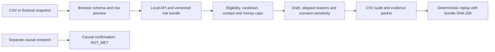
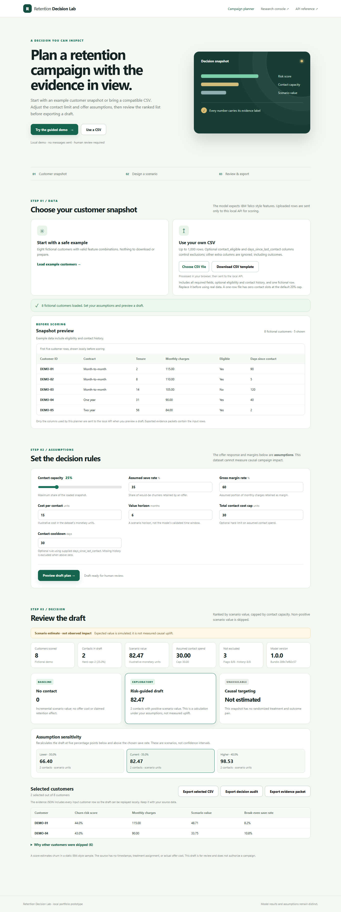

# Retention Decision Lab: portfolio case study

**Roles:** junior ML Engineer, AI Engineer, and Data Scientist  
**Status (30 September 2026):** local, reviewable decision-support prototype. The [evidence index](../reports/v4/EVIDENCE_INDEX.md) computes `ENGINEERING_FOUNDATION`; independent causal confirmation and a partner trial remain unmet.

## The decision

A retention analyst has a fixed contact capacity. The system scores a customer snapshot, excludes people who fail supplied eligibility or cooldown rules, and drafts contacts with positive value **under the analyst's stated assumptions**. The analyst can inspect every selected or skipped row, export the audit, and replay the decision against the exact model bundle. It does not send offers or assert that an offer saves a customer.

## Data and model work

The predictive dataset is IBM's static 7,043-row sample, fetched with a pinned SHA-256. A frozen 1,409-row test set follows development-only tuning and calibration selection. The [full benchmark reproduction](../reports/v4/portfolio_completion/FULL_BENCHMARK_COMPARISON.md) compared logistic regression, histogram gradient boosting, and CatBoost. CatBoost had a higher test AP (`0.6766` versus logistic `0.6396`), but the **predeclared development stability and complexity gate** retained logistic regression. All eight model metric rows and 1,409 test predictions matched the archived full run numerically. That is a model-selection and reproducibility result, not a claim that logistic is universally more accurate. The [quick reproduction](../reports/v4/reproduced_quick/RUN_MANIFEST.json) is for a faster demo and cannot be compared as an improvement over the full protocol.

The `/v1` API's `risk_30d` field is a legacy name; `/v2` and the planner now use `churn_risk_probability` with `horizon_status: unvalidated`. IBM has no validated 30-day prediction clock, treatment assignment, actual offer cost, or observed offer response. The UI calls the score static sample risk and labels monetary outputs as illustrative scenarios. See the [model card](MODEL_CARD.md), [data card](DATA_CARD.md), and [migration contract](RISK_FIELD_MIGRATION_EN.md).

## Product work

The [planner](../src/telco_churn/planner/index.html) accepts a fictional guided demo or up to 1,000 CSV customers. A downloadable fictional CSV template helps users prepare the required fields. The [browser roundtrip](../reports/v4/template_flow/result.json) confirms keyboard download, upload, preview, and a one-row no-contact draft under the default hard cap. The planner previews rows and required/optional fields, rejects invalid values with line and field feedback, and clears an earlier draft when inputs change. It applies hard contact and money caps, eligibility, cooldown, and a no-contact outcome. The evidence packet records input rows, assumptions, ranked decisions, model version, and bundle SHA-256. Replay reports `MATCH` only when the packet's deterministic decision fields agree with the same model bundle. The packet is not a signature or a campaign delivery log.

## Research judgment

Risk ranking and treatment-effect estimation answer different questions. The [Hillstrom development reproduction](../reports/v4/screening_reproduction/RUN_MANIFEST.json) completed eight learner comparisons, but its evaluator was selected after looking at prior results; the [confirmation decision](R09_CONFIRMATION_DECISION.md) keeps the one-use confirmation outcomes out of model comparison. The new [R1 transfer](../reports/v4/next_evaluator_transfer/TRANSFER_REPORT.md) found coverage failures in T2, T3, and T4, so neither the selected fixed-rule interval nor the new batch candidate was promoted. A separate [nested learner comparison](../reports/v4/learner_comparison/LEARNER_REPORT.md) retained M01 in the primary Hillstrom development branch. In the [frozen R4 allocation study](../reports/v4/exact_allocator_study/ALLOCATOR_STUDY.md), two solvers made identical decisions in all 4,500 synthetic batches because the cost geometry made feasible ranking exact. The separately frozen [R4b exploratory follow-up](../reports/v4/exact_allocator_study/r4b/ALLOCATOR_STUDY.md) found a positive estimated net difference under a revised cap, but its lower interval bound missed the declared decision margin. The [research execution summary](RESEARCH_EXECUTION_2026_EN.md) gives all roles and next steps. These studies are not telecom ROI. The evidence index's `ENGINEERING_FOUNDATION` tier reflects engineering gates only; its causal evaluator gate is `NOT_MET`, and `NO_LAUNCH` is an acceptable research result.

## Reproduce and inspect

1. Follow the [clean local setup](PORTFOLIO_RELEASE_2026_EN.md); `scripts/reproduce_benchmark.py --fetch` writes data, split, source, environment, model, and report hashes.
2. Open the planner and run the fictional demo. Set capacity to 25%, money cap to 30, and cooldown to 30 days; inspect why some customers are skipped.
3. Set the money cap to zero to show an empty draft. Export the evidence packet and replay it with `python -m telco_churn.replay`.
4. Review the [browser results](../reports/v4/portfolio_completion/BROWSER_VERIFICATION.md) and the [completion record](../reports/v4/portfolio_completion/IMPLEMENTATION_REPORT.md).

## What I would explain in an interview

| Question | Short answer |
|---|---|
| Why was the simpler model retained? | The declared development stability/complexity gate did not clear; I did not change that gate after seeing the test. |
| Does high churn risk mean an offer works? | No. It predicts an outcome under the sample's observed process, not a counterfactual response to contact. |
| Why can the plan contain zero contacts? | Hard constraints or non-positive assumed value can make no action the correct draft under those inputs. |
| What does replay prove? | Deterministic agreement of packet, code, and model bundle; it does not prove delivery, consent, or ROI. |
| What would permit a real launch claim? | A preregistered randomized pilot with known assignment probabilities, delivery and cost logs, mature outcomes, a valid uncertainty gate, and human approval. |

The [remaining-gaps plan](REMAINING_GAPS_AND_COMPLETION_PLAN_2026_EN.md) separates local engineering work from externally dependent validation. Five first-time-user sessions, a screen-reader pass, a hosted CI result, and a real partner pilot have not been observed.
