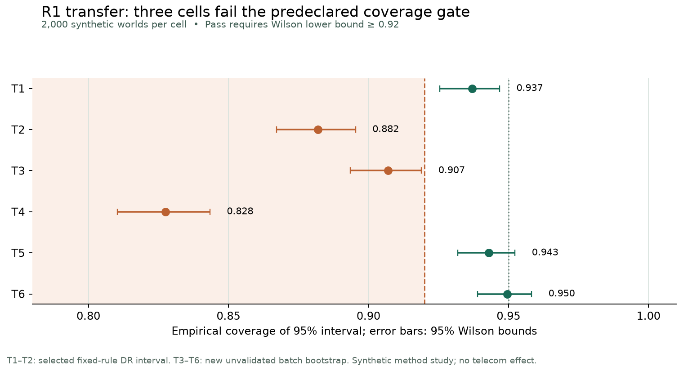

# Research execution: evaluator, learner, and allocation decisions

**Status, 30 September 2026:** completed local CPU studies with explicit negative and inconclusive findings. This page interprets the executed artifacts; the [frozen prospective R1/R4 protocol](NEXT_RESEARCH_EXPERIMENTS_EN.md) is retained unchanged for provenance. None of these public or synthetic studies measures telecom campaign uplift or return on investment.

| Study | Evidence role | Main observed result | Decision |
|---|---|---|---|
| [R1 evaluator transfer](../reports/v4/next_evaluator_transfer/TRANSFER_REPORT.md) | Six new known-truth synthetic cells, 2,000 worlds each | Selected fixed-rule interval coverage T2 **0.882**; new reallocation bootstrap T3 **0.907**, T4 **0.828**. Their Wilson lower bounds miss the declared 0.92 floor. | **No interval promotion.** T1/T5/T6 passing does not erase the failed cells. |
| [R1 broken controls](../reports/v4/next_evaluator_transfer/NEGATIVE_CONTROL_INTERPRETATION.md) | Separate 500-world synthetic diagnostic | Outcome-derived ranking yields sharp-null coverage **0.000** and false promotion **1.000**. The row-IID cluster control fails to discriminate: 0.946 versus 0.948 coverage. | Provenance guards caught injected fields in the harness; row-IID check remains inconclusive. |
| [R1 repair validation](../reports/v4/r1_repair_20261002/REPORT.md) | Six new known-truth synthetic cells, 2,000 worlds each | Fixed/null coverage **0.755**; batch/null **0.683**; batch/rare **0.758**; clustered candidate cells **0.892/0.893**. The new cluster control separated customer **0.955** from invalid row-IID **0.844**. A bounded safety reference covered all worlds but had half-width **182–466 conversions/1,000**. | **No interval promotion.** Five candidate coverage gates failed; a formally conservative but unusably wide interval does not support a campaign decision. |
| [R4 learner comparison](../reports/v4/learner_comparison/LEARNER_REPORT.md) | Hillstrom development; Lenta exploratory with assumed `e=0.75` | Inner-selected M03/M05/M07 versus fixed M01: Mens **-1.373**, Womens **+0.681**, Lenta **+1.389** conversions/1,000. Mens selection changed on every outer fold. | **Retain M01** for the Hillstrom scope. Lenta cannot determine that decision or claim confirmation. |
| [R4 allocator](../reports/v4/exact_allocator_study/ALLOCATOR_STUDY.md) | 90 known-truth worlds, frozen 2.0-unit money cap | Exact and feasible rank select exactly the same customers in all 4,500 batches because of the declared cost geometry. | Retain simple rank; original design cannot identify an advantage. |
| [R4b allocator](../reports/v4/exact_allocator_study/r4b/ALLOCATOR_STUDY.md) | Separately frozen post-R4 exploratory revision, 90 new worlds, 1.2-unit cap | Opposed-mechanism true net difference **+10.653 synthetic currency units/1,000**, 95% world interval **[0.396, 20.911]**. | Cautious exploration only: the lower bound misses the predeclared +1 planning margin. |

The [figure source](../reports/v4/research_execution/build_r1_figure.py) reads only the frozen R1 JSON and does not alter its cell decisions.

The [completed local nested-learner reproduction](../reports/v4/learner_reproduction_20261002/REPRODUCTION_REPORT.md) repaired run provenance and matched the archived scientific JSON fields for all three branches. It does not add independent evidence.

## What changed in the project

The decision lab now exposes a more useful negative result than a model leaderboard: an interval selected from earlier simulation does not transfer to a rare-event cell, and a new batch bootstrap is unreliable in two of its declared cells. The R4 learner procedure uses train-side selection and shared outer folds, yet its primary development branch does not improve on M01. The allocator study first uncovered a structural equivalence, then a separate exploratory revision showed why more restrictive money caps can matter without justifying a new policy. All source/config/result hashes are recorded with the individual reports. The research [evidence index](../reports/v4/EVIDENCE_INDEX.md) tracks these as artifacts while retaining the independent evaluator and partner-trial blockers.

## Next bounded protocol

1. **Keep the evaluator gate closed.** The [bounded R1 repair design](R1_REPAIR_DESIGN_EN.md) was frozen and run on new worlds; five candidate cells failed. The stronger cluster control worked, but it cannot rescue coverage. Any further estimator is a new protocol and needs independent worlds before promotion.
2. **Keep public comparisons developmental.** Retain M01 for the Hillstrom Mens scope until a validated evaluator and an independent, correctly logged assignment design support a single preregistered policy comparison. Do not open the existing one-use Hillstrom confirmation because a sensitivity branch or assumed-propensity Lenta result looks positive.
3. **Test allocation where it can differ.** Any new cost grid or money cap must be frozen with independent worlds before true outcomes are evaluated. Report predicted objective and true net separately, including the sharp-null cost-only mechanism. R4b is a selected exploratory signal, not independent confirmation.
4. **Run user and partner gates outside this repository.** A screen-reader operator and first-time users must evaluate the planner's comprehension and recovery flow. A telecom pilot needs consent/eligibility records, assignment and delivery logs, real costs, mature outcomes, a preregistered decision rule, and human approval. These data are unavailable in the public benchmarks.

The completed studies do not justify GPU training. A [Kaggle CPU kit](../kaggle/README.md) is now prepared for the previously unrun full-development Lenta learner comparison, using the fixed source, inputs, roles, and seeds. Its result remains pending; the completed 60,000-row run remains the reported exploratory evidence until the full artifact is returned and verified.
