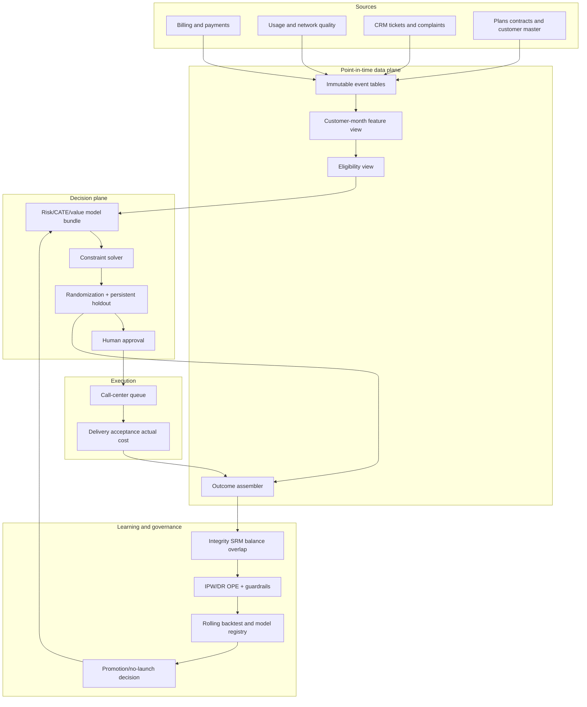

# Product architecture v2 — Retention Decision Lab

## Product boundary

Sản phẩm là một **reviewable campaign decision system**, không phải endpoint trả `will_churn=true` và
không tự gửi ưu đãi. Primary user là retention analyst/experiment owner; secondary users là data
scientist, call-center ops, finance và risk/legal reviewer.

Một run phải tạo được: eligible population, risk/CATE/value scores, treatment/control assignment,
ranked action list, assumptions/cost version, approval record, outcome window và evaluation lineage.

## Decision timeline

```text
T-90d ... T-1d                  T                    T+1 ... T+60d       T+180d
events available --------> snapshot/eligibility -> assign/deliver ----> churn label -> margin/guardrails
                              ^ features stop here    ^ action log        ^ delayed       ^ long-term
```

Contract:

- entity: active subscription/customer/household đã định nghĩa;
- feature: `event_time <= snapshot_at` và `available_at <= snapshot_at`;
- action: `offer_id` hoặc no-contact, propensity được randomization service log;
- immediate outcome: delivery/contact/acceptance;
- primary outcome: churn trong 60 ngày;
- value outcome: contribution margin trong 180 ngày − contact/offer cost;
- decision: top policy trong capacity sau eligibility/guardrails, hoặc `no_contact`.

## Logical architecture



## Storage contracts

| Table | Grain/key | Fields bắt buộc |
|---|---|---|
| `customer_event` | event | customer hash, event/available time, type, value, source hash |
| `customer_snapshot` | customer × snapshot | feature view version, eligibility, feature vector, source watermark |
| `policy_version` | policy version | model refs, objective, constraints, budget, cost assumptions |
| `decision` | decision ID | snapshot, score, rank, proposed action, policy/model version |
| `assignment` | decision ID | treatment, propensity, randomization unit/block/seed |
| `delivery` | attempt | channel, timestamps, contacted, accepted, failure, actual cost |
| `outcome` | decision × horizon | churn, margin, complaint, downgrade, availability time |
| `evaluation_run` | run | cohort/filter, estimator, CIs, code/data hashes, gate result |

Assignment là immutable; delivery không overwrite assignment. Không inner-join bỏ control hay failed
delivery. Nếu randomization unit là household, mọi subscription trong household dùng cùng assignment.

## Training pipeline

1. Resolve snapshot cohort bằng `available_at` watermark.
2. Validate schema, uniqueness, outcome completeness và treatment semantics.
3. Split rolling-origin theo campaign time; group theo randomization unit.
4. Cross-fit nuisance outcome/propensity; fit risk/S/T/DR candidates.
5. Evaluate outcome calibration, ATE, AUUC/Qini, uplift/value@capacity và guardrails.
6. Select model/capacity trên development only; freeze config/hash.
7. Evaluate locked future window; apply evidence/complexity/safety gate.
8. Save immutable bundle, score semantics, intended population, training time range và decision state.

Orange public file thiếu time/customer IDs nên dùng frozen joint-stratified holdout; limitation này hiện ở
mọi report. Synthetic panel chạy đúng rolling-origin để test pipeline, không thay thế real temporal data.

## Scoring and campaign pipeline

```text
feature view -> schema gate -> eligible rows -> model score
             -> cost/value join -> constraints/cooldown
             -> candidate list -> randomized exploration/control
             -> preview -> human approval -> export/queue
```

Batch là primary. API phục vụ preview/integration, không tự assign hay gửi treatment. Tie-breaking dùng
stable hashed ID; rerun cùng snapshot/policy phải idempotent.

Output mỗi row:

```json
{
  "decision_id": "...",
  "customer_id_hash": "...",
  "risk_60d": 0.08,
  "cate_prevented_churn": 0.012,
  "incremental_value": 3.40,
  "recommended_action": "offer_2",
  "selected": true,
  "rank": 147,
  "model_version": "...",
  "policy_version": "...",
  "score_semantics": "E[Y(0)-Y(offer_2)|X]"
}
```

Không trả CATE cho model risk-only. Với Orange anonymized, không tạo human-readable reason codes.

## Evidence gates

| Gate | Promote | Investigate | Reject/no-launch |
|---|---|---|---|
| Integrity | no SRM, propensity/log complete | small balance anomaly | broken assignment/join |
| Outcome | OOT calibration within tolerance | recalibration possible | Brier skill ≤ 0 / drift unexplained |
| Causal | IPW/DR same sign, lower CI > 0 | wide CI, low events | negative/inconsistent |
| Value | lower CI net value > 0 | break-even close to cost | expected loss |
| Stability | folds/months stable | one-window regression | repeated sign flip |
| Guardrail | non-inferior | low-power | complaint/debt/contact harm |
| Engineering | schema/parity/perf/rollback pass | warning | cannot audit/replay |

No model can bypass data/integrity/safety gates by having higher AUUC.

## Monitoring

- real-time: schema errors, score latency, queue age, randomization SRM, delivery failure;
- daily: population/score/selection/propensity/contact-frequency drift;
- after label maturity: ATE/IPW/DR, calibration, policy value, guardrails, effective sample size;
- monthly: rolling-origin challenger report, treatment-effect stability, power forecast;
- rollback: policy/model aliases point to immutable previous versions; assignment history remains intact.

PSI is triage, not proof of model decay. Outcome and policy metrics must be compared by time; automatic
retrain is prohibited until integrity and business changes are reviewed.

## Security and governance

- hash/pseudonymize customer IDs in analysis artifacts; raw IDs stay in execution zone;
- least-privilege access between warehouse, scoring, randomization and call center;
- secrets outside images/repo; signed immutable decision logs;
- retention/expiry policy for feature and campaign tables;
- legal review for contact consent, protected/proxy variables and personalized pricing;
- human approval and dual control before action export;
- model card lists population/horizon/treatment and prohibited extrapolation.

## Implemented vs target

| Capability | Hiện có | Cần production data/system |
|---|---|---|
| IBM risk pipeline, calibration, API/Docker | Có | external temporal validation |
| Orange randomized uplift benchmark + no-launch gate | Có | campaign/time/customer IDs, costs |
| Synthetic point-in-time/drift/known regret lab | Có | replace DGP with actual event history |
| IPW/DR, MDE, break-even, policy capacity | Có | cluster RCT + real margin/guardrails |
| Assignment/delivery service | Contract only | auth, idempotency, call-center integration |
| Persistent warehouse outcomes | migration skeleton | governed production pipelines |
| Automated action | Cố ý không có | chỉ mở sau legal/ops/evidence approval |
