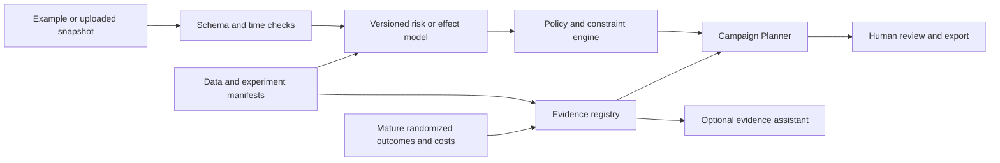

# Retention Decision Lab: project review and growth plan

**Reviewed:** 24 September 2026  
**Audience:** junior ML Engineer, AI Engineer, and Data Scientist candidates  
**Status:** review and proposed work. Reported experiment results are existing repository artifacts; this review did not retrain the benchmark models or open the Hillstrom confirmation split.

> **29 September update:** This document preserves the 24 September assessment. The [current case study](../PORTFOLIO_CASE_STUDY_EN.md) includes full IBM and Hillstrom development reproductions; the refreshed [evidence index](../../reports/v4/EVIDENCE_INDEX.md) computes `ENGINEERING_FOUNDATION` from engineering gates while causal confirmation and a partner trial remain unmet.

## Executive decision

Keep the project centered on one decision: **which eligible customer, if any, should receive which retention action under a contact and spending limit?** The strongest portfolio story is a defensible path from data to a decision a human can review. The existing project has unusually deep research controls for a junior portfolio: four public data sources (IBM, Orange, Hillstrom, and Lenta), a synthetic mechanism lab, immutable data roles, candidate families, paired policy evaluation, validity simulations, tests, an API, and a read-only console. Its next step is to make those pieces consistent, reproducible, and easy for an analyst to use.

The immediate order is:

1. Fix the evaluator gate and make CI match the current repository.
2. Publish a concise, current English project entry point and a reproducible, bounded experiment matrix.
3. Build an interactive Campaign Planner around the existing API, with an explicit choice between *risk scenario* and *estimated treatment effect*.
4. Run a small number of registered, high-information method comparisons; preserve the Hillstrom confirmation split until one deterministic selection rule and its estimand are frozen.
5. Add an AI assistant only if its grounded answers and refusal behavior pass an evaluation set.

No real business return has been demonstrated. The right public claim today is **research-replicated decision support on public and simulated data**, with domain-specific limits stated beside every result. A prospective randomized campaign with mature outcomes and actual cost records would be needed for business validation.

**Review basis:** source code, tests, configuration, current planning documents, archived reports, a fresh evidence-index build, and a direct local reproduction of the cohort-gate behavior. The user interface was reviewed from its HTML, JavaScript, and API code; no moderated usability study or visual browser assessment was performed. The archived metrics below were read from existing reports.

**Review checks:** all 47 Markdown links in this document resolve locally where applicable; 11 gate-related tests passed; source/test lint passed. The full test suite was stopped at 11% after a long review-only run, so it has no current pass verdict. The repository-wide format check failed with 65 files requiring reformatting. These checks support the findings below; they do not validate new model performance.

## 1. What exists, and what it proves

| Area | Current evidence | Honest interpretation |
|---|---|---|
| Predictive foundation | IBM Telco, 7,043 rows. Frozen test logistic AP 0.6396, ROC-AUC 0.8499, Brier 0.1345; 10% contact capacity captures 27.0% of observed churners. [Benchmark](../../reports/benchmark/BENCHMARK_REPORT.md). | Good ranking and calibrated-risk engineering on a static sample. IBM has no treatment assignment or timestamps, so the result cannot establish retention impact or future temporal performance. |
| Treatment evaluation | Orange has 11,896 rows and 408 churn events; observed average treatment effect is small and its interval crosses zero. The locked policy says NO_LAUNCH. [Claim ledger](../CLAIM_LEDGER_V4.md), [assignment audit](../../reports/v4/ORANGE_ASSIGNMENT_AUDIT.md). | Useful failure case. The pooled assignment is predictable from observed covariates, and the file lacks campaign, customer, time, and cost keys. Treat causal conclusions as conditional. |
| Multi-arm experiments | Hillstrom uses known assignment probabilities; Mens and Womens development branches rank candidates differently. [Research readiness](RESEARCH_READINESS.md), [R09 decision](../R09_CONFIRMATION_DECISION.md). | Demonstrates model-selection uncertainty. The untouched confirmation split remains unopened; neither branch is a final winner. |
| Independent domain | Lenta SMS development subset: 60,000 units, 6,498 events. A causal learner beat the baseline, while the prediction that larger data would stabilize hyperparameters failed. [R10 report](../../reports/v4/replication_lenta/EXTERNAL_REPLICATION.md). | Valuable falsification and external check. It is one different domain, not a general event-count threshold or proof of universal causal-learner superiority. |
| Mechanism testing | Synthetic temporal panel, known counterfactual effects, drift stress, two-stage recruitment and batch-cap simulations. [Evidence index](../../reports/v4/EVIDENCE_INDEX.md). | Tests implementation and failure modes under stated generators; does not measure market behavior. |
| Software | Package, CLI tools, FastAPI risk service, batch planning, artifact-based decision console, Docker Compose, locks, and test suite. [Source](../../src/telco_churn), [CI](../../.github/workflows/ci.yml). | Strong foundation. The console presents evidence well, but the analyst's end-to-end planning journey still requires other interfaces. |

The documented release tier was RESEARCH_REPLICATED on 21 September. A fresh local index build on 24 September reported **NONE** because the active interpreter had setuptools 78.1.0 while the research lock records 65.5.0. The only other incomplete tier gate was the prospective partner trial. This is an environment mismatch in the current interpreter, not evidence that all research artifacts vanished. It is nevertheless a reproducibility problem a reviewer can encounter immediately.

## 2. Review findings, in priority order

| Priority | Finding and evidence | Consequence | Proposed acceptance check |
|---|---|---|---|
| P0 | In [screening.py](../../src/telco_churn/screening.py), the whole-suite PASS returns before applying a supplied CohortDesign. A local probe with 100 units, propensity 0.99, event rate 0.001, and acted share 0.2 produced asymmetry index **69.65** against a licensed limit of **0.10**, yet gate_status returned True. | A new design far outside the measured validity region may be licensed. Make suite validity and cohort-region validity separate conditions; reject nonfinite and out-of-region designs before returning True. Add a regression test with this example and a valid boundary case. |
| P0 | [evidence.py](../../src/telco_churn/evidence.py) marks inference coverage PASS and uses it in release-tier computation, while [screening.py](../../src/telco_churn/screening.py) reports that the passing interval was **selected after looking** among equally powered, disagreeing runs. The [R09 decision](../R09_CONFIRMATION_DECISION.md) explicitly says the estimator needs independent confirmation. | A passing engineering diagnostic reads like confirmatory inference to a new reader. Show separate fields for mechanical gate, design scope, and independent-confirmation status. The public tier should not silently absorb a post hoc choice. |
| P0 | [CI](../../.github/workflows/ci.yml) runs formatting over the entire tree. A local check found **65 unformatted files**, including generated notebooks; lint passed. | A fresh pull request can fail before any research claim is reviewed. Choose and document one canonical format policy: format source/tests and generated notebooks from the notebook generator, or explicitly exclude generated notebooks from the format gate. Confirm on a clean checkout. |
| P1 | Several entries in the [evidence index](../../reports/v4/EVIDENCE_INDEX.md) were already marked stale relative to producer modules, including screening and validity artifacts. | The console can show a historical number with a current-code appearance. Rebuild affected artifacts from locked inputs or mark them visibly historical. Check artifact hashes and producer revisions in the UI. |
| P1 | The main [README](../../README.md) and most planning documents are Vietnamese, while the API and console are English. There are many versioned plans with different snapshot dates. | Recruiters need several minutes to find the current result, intended user, and demo path. Put a 60-second English overview, one architecture diagram, reproducibility command, and limitations table at the top-level entry point. Archive older plans as history. |
| P1 | The [decision console](../../src/telco_churn/webui/index.html) is an expert evidence browser. Its Orange capacity control is explicitly exploratory. The [risk API](../../src/telco_churn/api.py) already supports prediction and campaign preview, but the current console does not guide a user through upload, budget, policy comparison, review, and export. | The project proves research depth but less product judgment. Add a separate Campaign Planner flow using documented existing endpoints, keeping evidence views available through an Advanced tab. |
| P2 | The [benchmark](../../reports/benchmark/BENCHMARK_REPORT.md) shows CatBoost's frozen-test AP 0.6766 versus logistic 0.6396, while the predeclared complexity gate retained logistic. | Present this as a disciplined simplicity decision. Do not describe logistic as the numerically best test model; show the model-selection rule, uncertainty, inference cost, and value of the simpler deployment. |
| P2 | The local API benchmark reports warm p95 17.05 ms for sequential single-record requests on localhost. [Performance report](../../reports/api/PERFORMANCE_REPORT.md). | Useful engineering measurement with a narrow scope. Add concurrent load, cold start, memory, and batch-size tests before making a public service-level claim. |

The P0 cohort-gate finding is a direct code-level reproduction. It does not imply that previously analyzed cohorts were out of region; each historical cohort needs its own design audit. The release-tier issue is a communication and promotion-control defect even when the raw simulation result is correctly reported.

## 3. Target product and expanded problem

**Primary user:** a retention analyst who has a customer snapshot, a limited number of contacts, and a draft offer budget. They need a recommendation they can inspect, change, and export for human review.

**Product promise:** “Create a reviewable retention plan, see which assumptions drive it, and know when evidence is insufficient to recommend an action.”

This supports three linked questions:

1. **Risk:** Who is likely to leave within a stated horizon? Applicable to the IBM track, with the time-horizon caveat because IBM lacks timestamps.
2. **Incremental response:** Who benefits because of an action? Applicable only to randomized or credibly identified treatment data, with support and uncertainty checks.
3. **Allocation:** Which feasible actions maximize estimated net value under capacity, monetary, eligibility, cooldown, and complaint limits? The UI must distinguish estimated causal reward from assumed scenario value.

The same product can host four modes with explicit evidence labels:

| Mode | User action | Output language | Gate |
|---|---|---|---|
| Guided demo | Load a bundled de-identified example and move budget/offer assumptions. | “Simulated value under your assumptions.” | Always available if demo artifact is valid. |
| Risk planner | Upload an IBM-compatible snapshot; score and preview top-K. | “Predicted risk and scenario value.” | Schema, missingness, model-version, and data-integrity checks. |
| Experiment replay | Select Hillstrom or Lenta study; compare frozen policies. | “Estimated policy value on a development experiment.” | Design propensity, outcome maturity, support, sample size, and estimator scope. |
| Research evidence | Inspect sensitivity, failures, manifests, and historical reports. | “Observed / conditional / simulated / planned” beside each figure. | Artifact validity, stale status, preregistration and split role. |

For a later partner pilot, extend the problem to action choice across no contact, email, SMS, support call, and offer variants; delayed or censored churn; contact fatigue; competing costs; and monthly capacity. These require new longitudinal assignment, delivery, cost, and outcome data. The public datasets cannot supply actual telecom offer response, customer lifetime margin, or live intervention safety.

### Proposed screen flow

1. **Welcome:** one sentence, a 90-second demo button, and two example questions. Show the user's next action immediately.
2. **Data:** choose demo or upload; present schema match, excluded rows, data dates, consent/eligibility flags, and fixable errors. Do not score until the snapshot passes.
3. **Design:** set action, contact cap, money cap, horizon, margin and contact/offer costs. Each estimated versus assumed field gets a visible source label.
4. **Compare:** cards for No action, Risk ranking, and eligible uplift policies; show expected contacts, costs, uncertainty interval, net-value range, and why a card may be unavailable.
5. **Review:** inspect the selected list and reason codes, edit exclusions, see which changes are exploratory, and require human approval.
6. **Export:** download a plan CSV plus a short evidence packet containing data/model/config hashes, assumptions, policy, missing-data counts, and limitations.

Use ordinary language on the main screens: “Evidence insufficient to recommend launch” instead of an unexplained NO_LAUNCH; offer a short “Why?” panel for analysts who want the event counts and interval. Show an empty-state example when an artifact is unavailable. Preserve a keyboard-accessible table, focus indicators, labels, chart descriptions, and a text equivalent for visual metrics. The [WCAG 2.2 quick reference](https://www.w3.org/WAI/WCAG22/quickref/) is an appropriate accessibility checklist.

**Minimum product acceptance:** a first-time user can complete the guided flow in under five minutes without reading the research README; every value card identifies its data domain and whether money inputs are assumed; invalid inputs yield actionable feedback; a reviewer can reproduce the export from its manifest; all key actions work by keyboard and on a mobile-width screen. Time the first criterion in five moderated tests with people unfamiliar with the repository, and record completion, errors, and confusion rather than declaring usability from the UI implementation alone.

## 4. Experimental method: a common contract

Before adding models, define a single registered comparison contract for each dataset and endpoint:

| Item | Required declaration |
|---|---|
| Population and time zero | Eligible unit, assignment unit, observed feature cutoff, action availability, outcome maturity, repeated-unit handling. |
| Outcome and sign | Churn prevented, conversion, or monetary reward; fixed horizon and units. Do not compare values on different endpoints as if they shared a scale. |
| Policy class | No action, random, control-outcome ranking, risk ranking, S/T/DR, and limited challengers. State whether a score is an effect estimate or only a ranking. |
| Allocation | Contact fraction, monetary cap, offer cost, tie-breaking, feasibility, and whether the policy may choose no action. |
| Data roles | Fit, tuning, calibration, development evaluation, and untouched confirmation IDs; hash the manifest before evaluating. |
| Primary estimand | Whole eligible-cohort value difference per 1,000 units under a deployment-style batch cap; include no-action value and costs when costs are observed. |
| Primary evaluation | Paired DR value difference with known design propensity when valid, IPW sensitivity, event and effective-sample counts, batch-aware interval, and a design-scope check. |
| Selection | One primary contrast and one deterministic algorithm-selection rule; fixed model and tuning budgets; report all candidates and failed runs. |
| Reproducibility | Dataset and code hashes, dependency lock, seeds, hardware, runtime, fold predictions, model IDs, artifacts, and an executable command. |

For risk work, report AP, Brier/log loss, calibration plots, recall and precision at budget, slice stability, inference cost, and time/generalization limits. A lower Brier loss does not by itself prove better calibration; inspect reliability separately. Calibration should be fitted on predictions independent of the underlying model's fitting data, as documented by [scikit-learn](https://scikit-learn.org/stable/modules/calibration.html).

For causal work, use whole-population policy value and a locked budget as primary metrics. Report uplift curves or RATE as secondary ranking diagnostics, with interval and multiplicity rules. [GRF's RATE guide](https://grf-labs.github.io/grf/articles/rate.html) explicitly separates a ranking rule from an estimated individual effect and evaluates a rule on a separate test set; that distinction fits this repository's M01 baseline. Never calculate individual “true uplift” from one observed outcome in real data.

For all comparisons, include negative controls, same folds and rows, compute budget, training failures, sensitivity to propensities and costs, and an uncertainty interval for **the paired difference**. Positive point estimates without enough control-arm events should remain exploratory. Distinguish within-fold variation from uncertainty over new samples and campaigns.

## 5. Registered experiment backlog

These are proposed experiments, not results. Add a short preregistration record for each experiment before reading new outcomes. “Advance” means spend time on the next stage, not automatically promote a product policy.

| ID / priority | Question and design | Comparator; primary readout | Advance or stop rule |
|---|---|---|---|
| E01 / P0 | **Cohort validity:** can the actual estimator interval cover its target outside the originally swept constant-propensity generator? Use independent seeds, variable propensity, rare events, and batch caps; reserve entire generator families for evaluation. | Current interval versus stratified and batch resampling; coverage, width, false promotion and declared scope. | Tighten or remove licensing for regions that fail. A failed region is a useful result. |
| E02 / P0 | **Reproducibility:** rebuild one IBM run and one Hillstrom development screen from raw download through final report in a clean locked environment. | Existing archived artifact; hashes, prediction parity, time and failure count. | Ship a one-command path only when inputs, commands, and output schemas match. |
| E03 / P0 | **Model ranking uncertainty:** rerun the same fixed eight candidates on Hillstrom Mens/Womens development and Lenta with equal budgets and paired folds; quantify cross-domain rank reversals. | M01 and no action; paired value differences and rank confidence set, not “winner count” alone. | If no candidate separates reliably, publish an inconclusive model-selection result and freeze a simple policy. |
| E04 / P1 | **Data efficiency:** compare S, T and DR as arm event counts vary in a known-effect simulator, independently varying total N, control share, effect size, and heterogeneity. | M01, no action; true policy regret and estimated whole-cohort value. | Add a complex learner only in a measured region where it beats M01 on value with acceptable variance and runtime. |
| E05 / P1 | **Effect-estimator extensions:** trigger one X-learner and one R-learner using the implementations already explored in [model tournament](MODEL_TOURNAMENT.md), adapted to the current common contract. Test arm imbalance and nuisance misspecification. | Current S/T/DR finalists; paired value and regret in simulation. | Continue only if the extension improves a stated failure mode; do not infer uplift quality from outcome AP. |
| E06 / P1 | **Honest causal forest:** compare one fixed forest recipe on a dataset with enough events and known design probability. | Best simple effect learner; policy value, RATE, run time and sensitivity across seeds. | Keep only if benefit survives paired uncertainty and compute accounting. [GRF's causal-forest documentation](https://grf-labs.github.io/grf/reference/causal_forest.html) specifies honest splitting as a design option. |
| E07 / P1 | **Cost and budget policy:** compare rank-and-skip, exact small-instance optimization, and a shallow direct policy tree in known-reward simulation; then replay feasible policies on real randomized data using recorded outcomes only. | No action and simple ranker; true regret in simulation, DR value on real data, constraint violations. | Any budget/eligibility violation blocks advancement; efficiency gain must cover the additional complexity. [Policytree](https://grf-labs.github.io/policytree/) is a reference for direct policy learning. |
| E08 / P1 | **Risk-model challenger:** under the existing IBM split, compare logistic/HGB/CatBoost to one tabular foundation-model checkpoint in development only; use equal or explicitly reported compute and independent calibration. | Frozen logistic reference; development AP, Brier, calibration, recall at cap, memory/latency. | Do not reuse the already-open test to crown a new model. Acquire a genuinely new evaluation set or label the analysis exploratory. [TabArena](https://arxiv.org/abs/2506.16791) motivates validation-method and compute transparency. |
| E09 / P1 | **Transfer and drift:** use the synthetic temporal panel and a future longitudinal dataset if acquired; freeze models and test post-change risk, calibration, policy value and harmful-contact rate. | No action, risk-only, and robust effect policy. | Select by a preregistered lower-bound or regret criterion; show the price of conservative abstention. |
| E10 / P2 | **Censored outcome:** after obtaining real timestamps and follow-up completeness, compare discrete-time hazard and survival forest with IPCW evaluation. | Fixed-horizon logistic and no action; time-dependent Brier, discrimination and policy value at target horizon. | Defer on IBM, Orange, Hillstrom, and Lenta if usable follow-up timing is absent. [scikit-survival's evaluation guide](https://scikit-survival.readthedocs.io/en/stable/user_guide/evaluating-survival-models.html) gives appropriate censored-data metrics. |
| E11 / P2 | **Large randomized benchmark:** use the corrected Criteo uplift release as a separate advertising-domain stress test after source/license and compute review. | M01-like ranking, S/DR and no action; randomized policy value and event-count precision. | Explicitly use the corrected release: [Criteo documents leakage in the original release](https://ailab.criteo.com/criteo-uplift-prediction-dataset/). Do not pool effects with telecom or retail endpoints. |
| E12 / P2 | **AI evidence assistant:** create a fixed set of user questions about results, limitations, and assumptions; test retrieval-grounded answers from versioned local artifacts. | Search plus templated explanation; factual accuracy, correct evidence tier, citation validity, refusal rate, latency and cost. | Release only if no tested answer turns simulated value into observed ROI or recommends launch across a failing gate. [MLflow's RAG evaluation guide](https://mlflow.org/docs/latest/genai/eval-monitor/scorers/llm-judge/rag/) provides a framework; human review remains the primary correctness check. |

The first complete cycle should be **E01, E02, E03, E04, E07, and a thin slice of E12**. E05/E06/E08 are conditional challenger studies. E10/E11 need new data or compute. This keeps the project broad enough to demonstrate technical judgment while allowing a coherent release.

### Practical execution budget

Use a two-stage funnel. A smoke run tests contracts on tiny fixtures. A development screen uses common folds, bounded configurations, and a logged CPU ceiling. A confirmation run uses one frozen policy-selection recipe and one previously untouched evaluation role. Do not rename an exploratory rerun as confirmation. Estimate resource needs from a one-cell profile before starting a large factorial or Monte Carlo grid.

For method comparisons, report the full table even when the new method loses. Parameter stability is a diagnostic; it is **not a prerequisite that one exact parameter wins every fold or domain**. A deterministic training-and-selection algorithm can be preregistered and evaluated as a whole. The [R09 decision](../R09_CONFIRMATION_DECISION.md) explains why the current proposed recipe was not ready; revise the recipe and evaluator through independent development evidence, then freeze it before any new confirmation.

## 6. Engineering and product architecture

Keep one Python model/decision core behind both the API and planner. The existing risk API serves IBM-style customer records; the experiment console serves artifacts. Introduce a typed **study/policy result contract** shared by both views: dataset, endpoint, unit, split role, policy ID, evidence tier, estimate, interval, assumptions, valid-design region, artifact hash, and status. The UI should never infer these labels from filename or free text.

For a portfolio demo, use static example data plus read-only local planning first. Do not expose the current unauthenticated evidence console on the public internet. Before a public upload feature, add file-size and row limits, schema previews, private temporary storage or in-memory processing, deletion policy, rate limiting, and a clear statement of whether records leave the browser or host. Avoid customer identifiers in screenshots and shared artifacts. The user should approve a plan; no campaign delivery integration is required for the demo.

If an AI assistant is built, it should retrieve only allowlisted, versioned evidence artifacts and answer questions such as “Why is launch blocked?” or “Which metric supports this comparison?” It may explain a calculation and link to its source. It must not invent a customer-specific causal effect or silently run a new model. Record the retrieved artifact IDs with every answer, use templates for high-risk status messages, and allow “I cannot determine that from these data.” Measure hallucination and incorrect-tier rates on adversarial as well as ordinary questions.

## 7. Twelve-week roadmap, at 12–16 focused hours per week

| Weeks | Deliverable | Exit evidence |
|---|---|---|
| 1–2 | Repair the cohort-scope gate, separate independent-confirmation status, resolve format policy, restore a clean locked-environment run. | Regression probe is rejected; clean-checkout lint/format/tests pass; a fresh evidence index reports the expected gates and revision IDs. |
| 3–4 | Publish one English README route, a dataset/evidence catalog, single-command reproducibility for IBM and one Hillstrom development result, and an experiment registry. | Another machine can fetch allowed data, verify hashes, and reproduce one compact report; historical and current artifacts are visibly separated. |
| 5–6 | Deliver the Campaign Planner vertical slice: example data, validation, budget assumptions, no-action/risk comparison, review, export. | Five first-time users attempt the flow; observed failures are fixed; exported evidence packet regenerates the displayed decision. |
| 7–8 | Execute E01 and E03 plus a bounded E04; write preregistered predictions and full negative results. | Coverage and scope table, paired value table, event counts, runtime, and explicit stop/continue decisions. |
| 9–10 | Execute E07 and one triggered challenger from E05/E06/E08; add drift replay to planner. | Constraints are verified on fixtures and replay; challenger has matched-fold, matched-budget comparison and honest uncertainty. |
| 11–12 | Add and evaluate a small evidence assistant if E12 passes; package a 3-minute demo, architecture diagram, model/data cards, reproducibility commands, and interview notes. | Demo works from a clean install; all numeric claims link to artifacts; remaining limits and future partner-trial needs are visible. |

This is a planning estimate of **144–192 focused hours**. It excludes a live telecom pilot, custom data acquisition, production authentication, and large foundation-model sweeps. If time is tight, preserve weeks 1–8 and the demo packaging; the AI assistant is a conditional extension, not the portfolio's central proof.

## 8. What makes this stand out for junior hiring

| Role | Evidence a reviewer should see in five minutes | Strong interview discussion |
|---|---|---|
| ML Engineer | One-command reproduce path, data and model versions, training/serving parity, API and planner, CI, latency context, failure tests, and a clear rollback story. | Why the simpler logistic model was retained by a declared rule; how preprocessing and model artifacts stay consistent; how an invalid cohort is rejected. |
| Data Scientist | Precise estimand, data audit, baseline and negative controls, matched experiment comparisons, power/event counts, intervals, sensitivity, and honest null results. | Why risk is different from treatment response; why Hillstrom branches disagree; what the Lenta result does and does not generalize. |
| AI Engineer | A narrow, useful evidence assistant tied to retrieved artifacts; a labeled evaluation set; abstention and source display; latency/cost measurement. | How the assistant prevents simulated ROI from becoming a factual claim; how changing artifacts invalidate cached answers; when a template is safer than generation. |

The portfolio landing page should offer **demo, result, and code** within one screen: a 90-second guided demo, one visual of risk versus treatment effect, a small “what failed” card, and links to the reproducibility packet. A short case study should state the user problem, decisions taken, strongest measured result, rejected hypothesis, product screenshot, and one unresolved limitation. Avoid a generic “state of the art” claim; the honest technical story is stronger.

### Definition of done for the portfolio release

- A recruiter can run the guided demo without raw private files and can identify the product's user and decision in 30 seconds.
- A clean environment passes CI and reproduces at least one predictive and one causal-development result from documented commands.
- Every public number has an artifact, dataset, split role, endpoint, denominator, uncertainty or reason it is absent, and an evidence label.
- The validity gate refuses a known out-of-region cohort even if the aggregate suite passed.
- A user can preview, compare, review, and export a plan; no unsupported policy is recommended as deployable.
- The project includes one registered model comparison that did **not** support a more complex model, plus a clear account of what was learned.
- The AI assistant, if present, passes an adversarial answer set and abstains when evidence is missing.
- The 3-minute demo and README tell the same story and point to the same current artifact revisions.

## 9. First implementation tickets

1. **Gate correctness:** restructure [screening.py](../../src/telco_churn/screening.py) so a whole-suite pass does not skip design-specific limits. Add a regression test with the 69.65-versus-0.10 case, boundary cases, and a changing-propensity rejection.
2. **Evidence schema:** add distinct mechanical-validity, design-scope, and independent-confirmation fields in [evidence.py](../../src/telco_churn/evidence.py). Recompute the current index rather than editing its markdown by hand.
3. **CI reliability:** make generated notebooks and formatter policy deterministic in [CI](../../.github/workflows/ci.yml); run lint, format, and tests in the same locked setup on a clean checkout.
4. **Reproduction command:** write a single documented command with dataset checksum checks and artifact revision comparison; keep confirmation data inaccessible to this command.
5. **Planner prototype:** use the existing preview endpoint to build example data → assumptions → comparison → export. Define the shared result contract before adding new front-end components.
6. **Research freeze:** register E01/E03/E04 primary contrasts, compute caps, seeds, and stop rules. Preserve the existing Hillstrom split until the evaluator and selection recipe are independently checked.
7. **Communication:** put a short English entry point in the README and link this plan, the current evidence index, and a single demo script.

## External research used

- [TabArena: living benchmark for tabular ML](https://arxiv.org/abs/2506.16791) — motivates validation and compute accounting across tabular families.
- [TabPFN study in Nature](https://www.nature.com/articles/s41586-024-08328-6) — supports one bounded small-data foundation-model challenger, not automatic adoption.
- [Current TabPFN-3.5 model card](https://huggingface.co/Prior-Labs/tabpfn_3_5) — its weights permit research evaluation but restrict commercial/production use; review the license before a public or commercial deployment.
- [GRF RATE guide](https://grf-labs.github.io/grf/articles/rate.html) and [causal-forest reference](https://grf-labs.github.io/grf/reference/causal_forest.html) — policy ranking and honest forest design.
- [Nie and Wager, R-learner](https://arxiv.org/abs/1712.04912) and [EconML meta-learners](https://www.pywhy.org/EconML/spec/estimation/metalearners.html) — bounded alternatives when nuisance error or arm imbalance is a measured bottleneck.
- [Policytree](https://grf-labs.github.io/policytree/) — interpretable direct policy-learning comparator.
- [Criteo uplift dataset and erratum](https://ailab.criteo.com/criteo-uplift-prediction-dataset/) — corrected large randomized benchmark and its leakage history.
- [scikit-learn calibration guide](https://scikit-learn.org/stable/modules/calibration.html), [scikit-survival evaluation guide](https://scikit-survival.readthedocs.io/en/stable/user_guide/evaluating-survival-models.html), and [WCAG 2.2 quick reference](https://www.w3.org/WAI/WCAG22/quickref/) — metric and user-interface checks.
- [MLflow RAG evaluation guide](https://mlflow.org/docs/latest/genai/eval-monitor/scorers/llm-judge/rag/) — evaluation design for the optional evidence assistant.

Research and product recommendations above are **inferences from these sources and the repository**, not results measured by the project. The proposed experiments and acceptance thresholds require registration before new evaluation data are opened.
