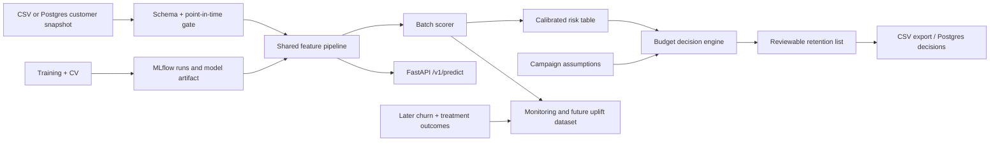

# Product and Architecture Design

## Product definition

TelcoChurn Decision System là công cụ **decision support** cho retention analyst, không phải hệ
thống tự động gửi ưu đãi. Hàng tháng analyst nạp/snapshot customer base, nhận calibrated risk,
chọn campaign assumptions và ngân sách, duyệt danh sách đề xuất rồi export. Mục tiêu thực tế của
portfolio là chứng minh khả năng nối data → model → decision → audit → service, không chỉ train
classifier.

### Primary user story

> Với vai trò retention analyst, tôi muốn tạo danh sách khách đủ điều kiện có expected value cao
> nhất trong ngân sách, xem lý do/model version/assumptions, và export một quyết định có thể audit.

### Không nằm trong MVP

- tự gửi email/SMS/discount;
- claim uplift/ROI thật;
- real-time feature lookup từ billing system;
- tự động quyết định price theo thuộc tính nhạy cảm;
- Kubernetes/cloud scale; 7k rows phù hợp một service nhỏ và batch job.

## Prediction and decision contract

- Entity: một customer đang active tại `snapshot_at`.
- Observation: feature chỉ từ dữ liệu có `available_at <= snapshot_at`.
- Intended label: churn trong `(snapshot_at, snapshot_at + 30 ngày]`.
- Score: calibrated probability `risk_30d`.
- Decision: `selected` theo eligibility + positive expected value + budget.
- Human control: analyst duyệt assumptions/list; hệ thống không kích hoạt campaign.
- Known gap: IBM sample không có timestamps, nên contract này chưa thể được validate bằng sample.

## System context

Một feature pipeline được share giữa training, batch và API để giảm training-serving skew; Google
khuyến nghị reuse code và đo skew giữa hai đường.[^1]

## Components

| Component | Responsibility | MVP acceptance |
|---|---|---|
| Data ingest | CSV/Postgres snapshot, checksum/run metadata | Idempotent, schema fail-fast. |
| Validator | types, enum, ranges, structural constraints | Same contract offline/API. |
| Trainer | split/CV/tune/calibrate/refit | MLflow logs hashes, params, metrics, artifacts. |
| Model bundle | preprocessing + estimator + calibrator + metadata | One immutable version, reproducible load. |
| Batch scorer | score all eligible rows | Stable ordering/tie-breaker by hashed ID. |
| Decision engine | EV, rank, count/spend budget | Deterministic, assumptions versioned. |
| FastAPI | health, metadata, prediction, campaign preview | Pydantic validation, no target in request. |
| Postgres | snapshots, predictions, campaigns, decisions, outcomes | Keys/FKs, audit timestamps, model version. |
| Monitoring | data/service/delayed-model metrics | Local report + log; alert thresholds documented. |

## API contract

### Endpoints

| Method/path | Purpose | Key behavior |
|---|---|---|
| `GET /health/live` | Process alive | Không load DB/model. |
| `GET /health/ready` | Model ready | Kiểm tra bundle/schema/version. |
| `GET /v1/model-info` | Audit | Model version, train data hash, metric summary, limitations URL. |
| `POST /v1/predict` | 1–1.000 records | Trả `customer_id`, `risk_30d`, `model_version`. |
| `POST /v1/campaigns/preview` | Simulate policy | Budget/assumptions + records; trả ranked list và summary, không persist/send. |
| `POST /v1/campaigns` | Future: persist approved plan | Ngoài MVP preview-only; cần auth/idempotency trước khi mở. |

Prediction response không trả hard `will_churn=true`; risk là uncertainty. Reason codes chỉ lấy từ
allowlist actionable/non-sensitive, ví dụ contract/service setup; không trả `gender` hoặc
`SeniorCitizen` như một lý do.

### Error behavior

- 422: missing field, unknown enum, invalid range/structural combination;
- 409: duplicate idempotency key với payload khác;
- 503: model chưa ready;
- không echo raw payload vào log; log request ID, schema version, latency, status.

FastAPI `TestClient` hoạt động với pytest/httpx và phù hợp cho integration tests của endpoint.[^2]

## Relational design

Migration MVP `sql/001_initial.sql` triển khai `model_versions`, `scoring_runs`, `churn_scores` và
`campaign_decisions` với PK/FK/check/index. `customer_snapshot`, approval workflow và observed outcomes
bên dưới là target schema khi nối warehouse thật, chưa phải chức năng đã triển khai trong API demo.

| Table | Primary key | Important fields |
|---|---|---|
| `customer_snapshot` | (`snapshot_at`, `customer_id`) | 19 features, `ingested_at`, `source_hash`, `schema_version` |
| `model_version` | `model_version` | run ID, code commit, data/split hash, calibration, created_at |
| `prediction` | (`score_run_id`, `customer_id`) | snapshot_at, risk, model_version, scored_at |
| `campaign` | `campaign_id` | budget type/value, assumption_version, status, approved_by/at |
| `decision` | (`campaign_id`, `customer_id`) | selected, rank, expected_value, reason codes, score_run_id |
| `outcome` | (`campaign_id`, `customer_id`) | contacted, treatment, actual_cost, churn_30d, observed_at |

SQL learning/implementation phải bao phủ constraints, joins, aggregates, transactions và window
functions; PostgreSQL tutorial chính thức có đúng các phần này.[^3]

## Decision engine

Inputs phải versioned: contact cost, expected offer cost/redemption, assumed save rate, gross margin
rate, horizon, eligibility, contact/spend budget. Output gồm selected count/spend, captured-risk sum,
expected value và break-even save rate.

`MonthlyCharges` không phải profit. `margin_at_risk = MonthlyCharges × horizon × assumed_margin_rate`
là simulation và phải hiển thị assumptions. Nếu thiếu treatment data, `assumed_save_rate` không được
gọi là estimated uplift.

## Testing pyramid

- Unit: parser, structural validation, top-K, knapsack, EV/break-even, deterministic tie handling.
- Data contract: exact schema/checksum, enum/range, new unknown category, point-in-time assertion.
- Model: no target/ID feature, transformer fit scope, probability bounds, serialization parity.
- Integration: train-small → save → load → API score; Postgres transaction rollback/idempotency.
- Golden: một payload cố định cho batch/API có score giống nhau `atol=1e-10`.
- Container smoke: build, start, readiness, predict valid/invalid.
- Performance: cold + warm p50/p95/p99 theo payload/concurrency đã khóa.

## Deployment and CI

Một `docker compose up --build` khởi động API + Postgres và chạy migration. MLflow tracking của trainer
dùng local SQLite `mlflow.db`, không nằm trong runtime compose.
Docker image dùng base version cố định, non-root user, dependency cache hợp lý, `.dockerignore`,
healthcheck và chỉ chứa runtime deps. Docker khuyến nghị multi-stage builds, trusted small base images
và rebuild thường xuyên.[^4]

GitHub Actions fetch dataset theo checksum rồi chạy lint, format check và unit/data-contract/API tests;
`setup-python` là cách GitHub khuyến nghị để khóa hành vi runner.[^5] Full benchmark và container smoke
được chạy ở release/local evidence vì model artifact cố ý không commit và full CV không phù hợp PR fast
suite.

## Monitoring and rollback

| Layer | Signals | Trigger/action |
|---|---|---|
| Service | request/error rate, p95/p99, readiness | rollback image/model alias nếu SLO fail. |
| Schema | missing/unknown/range/structural errors | reject batch; không impute âm thầm. |
| Distribution | prevalence when labels arrive, category mix, numeric drift | investigate; drift không tự động retrain. |
| Prediction | score distribution, selection rate, budget utilization | compare train/recent windows. |
| Delayed quality | AP, Brier, calibration, Recall@budget | challenger evaluation then reviewed promotion. |
| Outcome | treatment/control retention, cost, complaints | future uplift/guardrail analysis. |

Mỗi model bundle bất biến; deployment chỉ đổi alias/config pointer. Rollback là trỏ về version trước,
không overwrite artifact. Không auto-promote chỉ vì một metric tăng.

## Security and responsible use

- auth/RBAC cho create campaign; predict có request size/rate limit;
- secrets qua environment/secret store, không commit;
- customer ID hashed trong analytical artifacts; logs không chứa billing row;
- retention list có expiry và audit trail;
- human review, offer eligibility và complaint/contact-frequency guardrail;
- sensitive attributes chỉ audit/ablation; legal review nếu dùng dữ liệu thật.

## MVP Definition of Done

1. `make`/PowerShell one-command path từ fetch đến demo trên máy sạch.
2. Data card, model card, split manifest, benchmark table và ≥15 errors đều versioned.
3. Batch scoring + budget planning xuất CSV deterministic; migration DB sẵn sàng cho persistence phase.
4. API schema, unit/integration/golden/container tests pass trong CI.
5. Docker p95 được đo và ghi cùng CPU/RAM/OS/concurrency, không dùng con số thiếu context.
6. Business table gắn nhãn simulated, có conservative/base/optimistic + break-even.
7. Demo 3–5 phút đi qua input → risk → budget list → assumptions → audit/model limitations.

## Sources

[^1]: Martin Zinkevich, “[Rules of Machine Learning](https://developers.google.com/machine-learning/guides/rules-of-ml),” Rules 29, 32 and 37.
[^2]: FastAPI, “[Testing](https://fastapi.tiangolo.com/tutorial/testing/).”
[^3]: PostgreSQL Global Development Group, “[PostgreSQL Tutorial](https://www.postgresql.org/docs/current/tutorial.html).”
[^4]: Docker, “[Building best practices](https://docs.docker.com/build/building/best-practices/).”
[^5]: GitHub Docs, “[Building and testing Python](https://docs.github.com/en/actions/tutorials/build-and-test-code/python).”
