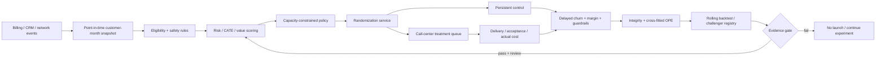

# Deep research: từ churn classifier đến retention decision system

Ngày nghiên cứu: 2026-09-14. Phạm vi: chọn dữ liệu, phương pháp, evaluation và product workflow cho
một portfolio project có thể bảo vệ bằng bằng chứng. Tài liệu ưu tiên nguồn dataset chính thức, paper
gốc và documentation chính thức; mọi kết quả trong repo được tách thành **real randomized evidence**,
**predictive sample evidence**, hoặc **synthetic mechanism evidence**.

## Mô tả ngắn gọn bài toán

Mỗi kỳ campaign, hệ thống nhận snapshot của các thuê bao đang hoạt động và một capacity/cost constraint.
Nó không chỉ hỏi “ai có khả năng churn?”, mà phải quyết định **ai nên nhận treatment nào** để tối đa hóa
incremental retained margin sau chi phí, trong khi giữ một randomized control, tôn trọng eligibility và
contact-frequency guardrails, rồi học lại khi outcome đến trễ.

Ba đại lượng không được đánh đồng:

1. `risk(x) = P(churn=1 | X=x)` — dự báo outcome;
2. `CATE(x) = E[Y(0)-Y(1) | X=x]` — churn được treatment ngăn;
3. `value(x,a) = CATE(x,a) × retained_margin(x) - cost(x,a)` — quyết định kinh tế.

IBM Telco chỉ hỗ trợ (1) trên sample tĩnh. Orange uplift hỗ trợ (2) trong một high-risk campaign pool.
Muốn làm (3) thật cần outcome/cost/margin/action log của doanh nghiệp.

## Tại sao phiên bản IBM-only chưa đủ giá trị

Pipeline IBM đã có split, calibration, budget metrics, API và CI, nhưng vẫn thiếu bốn bằng chứng:

- không có prediction timestamp nên không kiểm tra được point-in-time leakage hay temporal decay;
- không có treatment/control nên risk score không đo persuadability;
- không có contact/offer/margin thật nên “business impact” chỉ là sensitivity analysis;
- 7.043 hàng không phải benchmark quy mô, external validation hay operational experiment.

Giải pháp không phải thêm XGBoost/deep learning rồi báo AUC cao hơn. Cần đổi **decision problem**, dữ liệu
và protocol đánh giá.

## Chiến lược dữ liệu nhiều tầng

| Track | Dataset | Vai trò đúng | Không được claim |
|---|---|---|---|
| A | IBM Telco, 7.043 | EDA, schema, leak-free prediction, calibration, serving | temporal/generalization/causal ROI |
| B — core | Orange Belgium uplift, 11.896 | randomized treatment-aware policy benchmark thật | toàn customer base, offer-specific profit, temporal stability |
| C | synthetic customer-month, 80.157 | known CATE/potential outcomes, drift/leakage/regret tests | external validity |
| D | UCI Iranian, 3.150 | planning-gap external predictive probe | uplift; timestamps chi tiết |
| E | Criteo unbiased, 13.979.592 | scale/stress test cho uplift/OPE | telco transfer |
| F | KKBox WSDM 2018 | large temporal subscription behavior nếu chấp nhận Kaggle terms | treatment effect |
| G | KDD Cup 2009 Orange | high-dimensional churn predictive reference | campaign causality |

### Orange Belgium — benchmark chính đã triển khai

Bài báo mô tả ba campaign Sep–Dec 2020: churn model chọn high-risk customers, sau đó randomize control
và target; outcome churn đo trong hai tháng. Dataset có 178 feature/11.896 rows, control response 3,6%,
target 3,4%, treatment 75,74%.[^1] Đây là public churn-uplift data trực tiếp nhất cho câu hỏi retention,
nhưng feature đều ẩn danh và file không có campaign/customer/time ID.

Bài báo gốc báo Outcome RF AUUC 0,26±0,47%, Uplift RF 0,19±0,37%, T-learner RF 0,25±0,38%; uncertainty
lớn hơn mean và outcome model đứng đầu. Tác giả liên hệ kết quả với variance của counterfactual
estimation.[^1] Vì vậy repo không đặt gate “uplift learner phải thắng”; nó so risk/T/S/DR và cho phép
baseline hoặc no-launch thắng.

### UCI Iranian — probe cho planning gap

UCI ghi 3.150 customers, 13 feature, dữ liệu 12 tháng; feature là aggregate của 9 tháng đầu, label ở cuối
tháng 12 và có planning gap ba tháng, không missing, CC BY 4.0.[^2] Track này phù hợp kiểm tra horizon/gap
và external predictive robustness, nhưng không có treatment nên không thay Orange.

### Criteo unbiased — causal scale test

Criteo công bố randomized incrementality tests. Bản đầu 25,3 triệu rows có advertiser leakage; chính
tác giả phát hành bản unbiased 13.979.592 rows, 12 feature ẩn danh, treatment 85%, conversion 0,292%,
file nén 297 MB.[^3] Chỉ dùng bản unbiased để stress-test memory, distributed scoring, rare-outcome OPE
và estimator variance; nó là advertising, không phải bằng chứng telco.

### KDD Cup 2009 và KKBox

KDD Cup 2009 có Orange customer relationship tasks, 50k train/50k test; “small” có 190 numeric + 40
categorical, “large” có 14.740 + 260 variables.[^4] Official fast-track churn winner ROC-AUC khoảng
0,7611.[^5] Đây là reference predictive difficulty/high dimensionality, không treatment.

KKBox/WSDM 2018 cung cấp membership, transaction và user-log tables cho temporal churn prediction và
dùng log loss; phù hợp xây feature views/rolling backtest ở quy mô lớn, nhưng truy cập phụ thuộc Kaggle
account/competition terms và cũng không có randomized retention action.[^6]

## Phương pháp cần cải tiến

### Prediction layer

- Dummy, regularized Logistic: audit/calibration baseline;
- HistGradientBoosting/CatBoost: nonlinear tabular challenger;
- discrete-time survival/hazard: khi cần `when churn`, censoring và changing risk set;
- rolling-origin validation; calibration intercept/slope/Brier theo month;
- label delay và feature `available_at`, không random split trên customer-month.

Không dùng Accuracy làm primary khi churn hiếm. AP phải đọc cùng prevalence; temporal lab cho thấy
out-of-time AP có thể tăng chỉ vì base rate tăng trong khi Brier skill gần mất hết.

### Causal layer

- Risk model trên control: operational baseline, không gọi score là uplift;
- S-learner: một outcome model, counterfactual bằng thay treatment;
- T-learner: hai outcome models; dễ hiểu nhưng control nhỏ làm variance lớn;
- DR-learner: cross-fitted nuisance outcomes + orthogonal pseudo-outcome;
- future challengers: X-learner cho arm imbalance, causal forest/R-learner cho heterogeneity, multi-arm
  policy khi có nhiều offers.

Meta-learners được hệ thống hóa trong nghiên cứu của Künzel et al.[^7] Doubly robust OPE kết hợp outcome
regression và propensity, nhưng vẫn nhạy với weak overlap, finite-sample variance và distribution shift;
“doubly robust” không nghĩa là bất tử trước design/data failure.[^8]

### Decision layer

- Fixed top-K: khi constraint là agent capacity;
- positive incremental value: có quyền chọn ít hơn capacity hoặc 0;
- knapsack: heterogeneous contact/offer cost;
- constrained policy: cooldown, region/channel capacity, complaint/fairness guardrails;
- persistent exploration/control để policy mới còn evaluable;
- human approval; scoring service không tự kích hoạt campaign.

Profit-aware research nhấn mạnh ranking phải kết hợp incremental churn response, post-campaign cash flow
và intervention cost.[^9] Value-driven uplift literature cũng chỉ ra Qini/ITE quality không tất yếu đồng
nghĩa business value cao.[^10]

## Metric framework đầy đủ

| Layer | Primary | Supporting | Failure được phát hiện |
|---|---|---|---|
| Outcome risk | AP + prevalence, Brier skill | ROC-AUC, log loss, calibration slope/intercept | rare-event ranking, bad probability |
| Capacity | recall/precision/lift@K | captured risk, contacts/churn | model tốt tổng thể nhưng kém ở operating point |
| RCT integrity | SRM, propensity, balance | two-sample classifier, missing/delivery rate | broken randomization/data join |
| ATE | difference-in-means + CI | IPW/DR, event count, MDE/power | “campaign works” without power |
| Uplift ranking | OOF AUUC/Qini | uplift@K, fold/month stability | noisy CATE rank |
| Synthetic CATE | PEHE, bias, rank correlation | calibration by CATE decile | estimator recovery under known truth |
| Policy | DR/IPW value + cluster CI | prevented churns, break-even cost, ESS | ranking unrelated to decisions |
| Operations | p95/p99/error/SRM | throughput, cold start, queue age | technically unusable product |
| Guardrail | complaint/downgrade/debt/contact fatigue | slice selection/effect | local optimization causes harm |

Repo định nghĩa normalized AUUC rõ ràng: sort score giảm dần, `G(k)=Στ_i/n`, integrate theo fraction;
Qini = AUUC − ATE/2. Không so trực tiếp con số với package/paper dùng convention khác.

## Kết quả thực nghiệm hiện tại

### Real randomized Orange

- Full ATE prevented churn: +0,275 điểm %, 95% CI [-0,503; +1,053].
- 80% power MDE: 1,112 điểm %; xấp xỉ 194.060 rows để detect observed effect nếu assumptions giữ nguyên.
- Development OOF: DR-HGB Qini-DR 0,002020 đứng đầu theo Qini; risk-logistic có Qini-DR 0,001634 nhưng
  tạo tổng estimated prevented churn cao nhất ở candidate capacities nên policy lock là risk-logistic/30%.
- Locked holdout: DR uplift +3,331 điểm % [−1,507; +8,269]; IPW +1,076 [−3,587; +6,019]; Qini dương
  nhưng selected control chỉ có 15 churn events. Quyết định: `NO_LAUNCH`.
- Repeated development experiment (5 seeds × 3 folds): risk-logistic Qini-DR 0,002668±0,000938,
  dương 5/5 và rank trung bình 1,0. X-HGB chỉ 0,000008±0,000754, dương 2/5, thắng risk 0/5; giả thuyết
  “X-learner tự động giải quyết 75/25 imbalance” bị bác bỏ ở dataset này.
- 24-config risk tuning (4 feature sets × 6 C, 3 repeats): mean-best là all-178/C=3, nhưng one-SE rule giữ
  all-178/C=0,3. Đây là future-challenger result; không được mở lại holdout để promote.

Nhận xét có thể hành động: bottleneck không phải thiếu neural net, mà là insufficient control/events và
effect nhỏ. Việc hợp lý tiếp theo là thiết kế RCT lớn/cân bằng hơn, chuẩn hóa treatment và log cost/margin.

### Synthetic temporal mechanism test

- 80.157 customer-month/6.000 customers/18 months;
- true ATE đổi +0,649% trước drift thành −0,105% sau drift;
- harmful-offer share tăng 46,4% → 64,3%;
- tại test 20% capacity, risk-HGB true value −2.813 và harmful contacts 40,5%; S-HGB +1.133 và 25,8%;
  oracle value +5.815;
- validation uncertainty gate chọn `no_contact`; trên known truth nó tránh loss của mass/risk targeting
  nhưng bỏ lỡ best-oracle opportunity 6.806.

Đây là trade-off exploration vs conservative exploitation. Kết luận không phải “S-learner tốt nhất”; ở
DGP khác thứ tự có thể đổi. Kết luận là pipeline phải đo policy regret/harm/stability và giữ control data.

## Architecture sản phẩm đề xuất

Chi tiết table/event/API và ownership ở [ARCHITECTURE_V2.md](ARCHITECTURE_V2.md); experiment contract ở
[EXPERIMENTATION_PLAYBOOK.md](../EXPERIMENTATION_PLAYBOOK.md).

## Experiment roadmap — không chạy model zoo vô hạn

### Phase 1 — hoàn tất bằng chứng hiện tại

- khóa Orange provenance/license/split;
- OOF risk/S/T/DR + IPW/DR + holdout gate;
- known-CATE temporal drift lab;
- notebook audit có thể chạy lại;
- test sign convention, exact top-K, oracle exclusion, churn risk-set exit.

Exit: mọi headline number truy về CSV/JSON; no-launch là output hợp lệ. **Đã đạt.**

### Phase 2 — external predictive/scale validation

1. UCI Iranian: hypothesis “IBM ranking survives planning gap”; report AP lift/Brier/calibration, không
   claim uplift.
2. Criteo unbiased 1M/13,98M tiers: hypothesis “OPE pipeline giữ memory/runtime và stable Qini khi rare
   outcome”; giữ exact upstream license, không commit raw.
3. KKBox nếu access hợp lệ: point-in-time SQL features, customer/group split, rolling months, label delay.

Exit: dataset adapter contract chung; không có source-specific preprocessing ngoài loader.

### Phase 3 — production-like experiment platform

- randomization/assignment service + propensity logging;
- delivery/non-compliance/cost/margin/guardrail outcome schema;
- cluster bootstrap, effective sample size, SRM alerts;
- offer-level multi-treatment policy và cooldown;
- shadow → limited pilot → promoted policy workflow.

Exit: replay một campaign từ snapshot đến OPE không query future data; rollback/audit đầy đủ.

### Phase 4 — research challengers chỉ khi data support

- X-learner vì 75/25 arm imbalance;
- causal forest/R-learner vì nonlinear heterogeneity;
- survival + uplift cho time-to-churn/censoring;
- surrogate-index tests cho long-term margin;
- distributionally robust policy khi campaign/month shift.[^8]

Mỗi challenger phải có preregistered hypothesis, compute budget, primary metric, minimum improvement,
stability gate và ablation. Nếu chỉ tăng AUUC một fold nhưng value CI/temporal stability không tăng, reject.

## Definition of Done mới

Dự án chỉ được gọi “hoàn thiện” khi:

- mô tả đúng risk/CATE/value và intended population;
- có một real randomized track và một known-counterfactual mechanism track;
- checksum/license/schema/split/seed/data availability được audit;
- model/budget selection tách khỏi locked test;
- uncertainty/power/event counts xuất hiện cạnh mọi causal result;
- policy có `no_contact`, control/exploration và guardrails;
- benchmark có outcome, causal, economic, temporal và operational layers;
- notebook/report/code cho cùng số;
- tests ngăn sign inversion, oracle leakage, post-treatment feature và nondeterministic top-K;
- không claim revenue/causality/generalization ngoài data;
- production gap được biến thành experiment/data contract cụ thể, không phải “cần thêm dữ liệu”.

## Nguồn và phạm vi chứng cứ

[^1]: Verhelst, Mercier, Shrestha & Bontempi, “[A churn prediction dataset from the telecom sector: a new benchmark for uplift modeling](https://arxiv.org/abs/2312.07206),” 2023/ECML PKDD proceedings; [official code](https://github.com/TheoVerhelst/Churn-Uplift-Dataset-Paper); [OpenML 45580](https://www.openml.org/search?type=data&id=45580).
[^2]: UCI Machine Learning Repository, “[Iranian Churn](https://archive.ics.uci.edu/dataset/563/iranian%2Bchurn%2Bdataset),” DOI 10.24432/C5JW3Z, CC BY 4.0.
[^3]: Criteo AI Lab, “[Criteo Uplift Prediction Dataset](https://ailab.criteo.com/criteo-uplift-prediction-dataset/),” including official erratum and unbiased release figures.
[^4]: ACM SIGKDD, “[KDD Cup 2009 Data](https://www.kdd.org/kdd-cup/view/kdd-cup-2009/Data).”
[^5]: ACM SIGKDD, “[KDD Cup 2009 Results](https://www.kdd.org/kdd-cup/view/kdd-cup-2009/Results).”
[^6]: KKBOX/WSDM, “[Churn Prediction Challenge](https://www.kaggle.com/competitions/kkbox-churn-prediction-challenge).” Access and reuse are subject to Kaggle competition terms.
[^7]: Künzel et al., “[Metalearners for estimating heterogeneous treatment effects using machine learning](https://doi.org/10.1073/pnas.1804597116),” PNAS 116(10), 2019.
[^8]: Kallus et al., “[Doubly Robust Distributionally Robust Off-Policy Evaluation and Learning](https://proceedings.mlr.press/v162/kallus22a.html),” ICML 2022.
[^9]: Lemmens & Gupta, “[Managing Churn to Maximize Profits](https://doi.org/10.1287/mksc.2020.1229),” *Marketing Science* 39(5), 2020.
[^10]: Gubela & Lessmann, “[Uplift modeling with value-driven evaluation metrics](https://doi.org/10.1016/j.dss.2021.113648),” *Decision Support Systems* 150, 2021.
