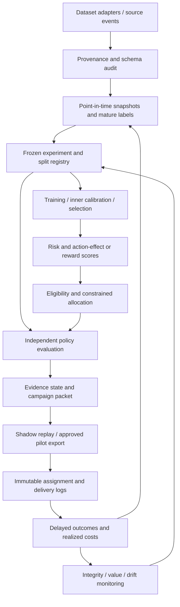

# Thiết kế hệ thống Retention Decision Research Platform — V3

Ngày hoàn thiện kế hoạch: 20/09/2026. Trạng thái: thiết kế để review, chưa triển khai. Liên kết: [roadmap](DEVELOPMENT_PLAN_V3.md), [research audit](REVIEW_RESEARCH_V3.md), [experiment specifications](EXPERIMENT_DESIGN_V3.md).

## 1. Sản phẩm cần tạo ra

Một analyst có thể nạp cohort đủ điều kiện tại một thời điểm, chọn capacity/cost policy đã version, nhận action list cùng bằng chứng đủ/chưa đủ, và tái tạo quyết định sau khi kết quả đến. Một researcher có thể thay một component, chạy cùng benchmark và biết thay đổi đó ảnh hưởng value, uncertainty, compute hay constraint nào.

Core product không phải dashboard leaderboard. Một campaign packet phải trả lời được: chọn ai/action nào, bỏ ai/vì sao, ngân sách và capacity dùng bao nhiêu, so với BAU khác gì, bằng chứng đến từ đâu, thiếu gì trước khi pilot, outcome nào cần chờ đến ngày nào.

Chưa có nghiệp vụ/khách hàng cụ thể xác nhận. Mặc định thiết kế phục vụ subscription/ISP retention; offer catalogue, cost và KPI ngoài dataset công khai là assumptions versioned. Không tự động gửi campaign trong research release.

## 2. Kiến trúc thực thi đề xuất

Evaluator nhận policy cố định và evaluation data; không được tự tune policy để score cao hơn. Policy optimizer nhận **predicted** action rewards/costs và constraints; không nhận true/observed future outcomes. Assignment nhận approved experiment design và eligible cohort, không tự thay treatment probability sau khi thấy kết quả.

Triển khai ban đầu là Python package hiện có + Parquet + local analytical SQL khi cần + file run registry/MLflow. Postgres dùng cho operational decision/assignment ledger khi bước pilot replay cần transactions. Không cần Kafka, Kubernetes hoặc online feature store trước khi batch pipeline và benchmark thực sự cần chúng.

## 3. Contract dữ liệu

| Bảng/artifact | Grain / khóa | Trường tối thiểu | Invariants |
|---|---|---|---|
| Dataset manifest | dataset version | source URL/version, retrieval time, raw hash, license reference, parser version, schema, evidence tier | Không dùng file đổi hash như cùng version |
| Account/subscription history | entity × validity interval | account key, subscription key, valid_from/to, available_at, plan, status | Không chồng interval ngoài semantics đã định; key không là feature |
| Event | source event/version | entity, event_at, available_at, event_type, value, correction_of | Append corrections, không mất dữ liệu đã thấy tại as-of cũ |
| Snapshot | entity × decision_at × feature_view_version | features, eligible, exclusion reason, source watermark/hash | Feature availability không sau decision_at |
| Label | entity/decision × horizon × label_version | outcome, window_start/end, available_at, complete/censored/missing, reason | Missing/immature khác 0; không sửa label version cũ |
| Split manifest | experiment revision × row | role, outer/inner fold, cluster key, time window, train cutoff | Một row không đồng thời train và evaluate trong cùng fit |
| Action catalogue | action version | action ID, semantics, channel, eligibility, cost rules, capacity use, cooldown | BAU có ID riêng; cost units rõ; assignment khác delivery |
| Score bundle | model × snapshot | risk target/horizon, expected outcome/reward từng action, effect, support flags | CATE không buộc [0,1]; probabilities phải [0,1]; không tráo dấu |
| Decision | decision ID | snapshot hash, model/policy/cost versions, candidate actions, chosen action, reason, constraints | Unique entity/campaign; chosen action feasible; cohort totals kiểm được |
| Assignment | experiment × randomization unit | arm, all assignment probabilities hoặc design ref tái tạo được, seed/block, assigned_at | Immutable, tổng probabilities=1, probability thực thi đúng design |
| Delivery | assignment × attempt | channel, attempt time, reach/acceptance, delivery failure, actual incremental cost | Không sửa assigned arm khi không liên hệ được |
| Outcome ledger | unit × outcome window/version | churn/time, cash flow, complaints, censoring, availability | Giữ mọi assigned units trong ITT population |
| Evaluation | run × policy comparison | estimand, units, horizon, estimator, uncertainty, support, gate, lineage | Không thiếu comparator/denominator/evidence tier |

Public datasets không có các trường cần thiết thì adapter phải ghi `unavailable`, không sinh timestamp/customer IDs giả rồi dùng như dữ liệu thật. Source-order row ID chỉ để reproducibility/tie-break.

### Bitemporal và label maturity

Event được dùng nếu cả `event_at <= decision_at` và `available_at <= decision_at`. Trong training tại cutoff T, label chỉ được dùng nếu window đã kết thúc và label available_at ≤T, trừ survival estimator xử lý censoring rõ ràng.

Ví dụ: ticket phát sinh ngày 01 nhưng về kho ngày 05 không được xuất hiện trong snapshot ngày 03. Charge corrected ngày 10 không được silently thay snapshot đã ra quyết định ngày 07. Replay phải phân biệt “biết gì lúc đó” với “bây giờ biết kết quả thật là gì”.

### Missingness và data contracts

Không biến unknown category thành “không có dịch vụ”; không coi missing cost là 0. Thiếu action cost có thể cho churn-ranking research nhưng phải chặn net-value recommendation. Thiếu propensity chỉ cho predictive track hoặc conditional causal analysis có assumptions, không cấp evidence level như randomized logs.

API/batch dùng cùng validator về domain, structural consistency và finite numeric values; khác biệt strict versus permissive behavior phải explicit qua mode, không âm thầm có policy khác nhau.

## 4. Phân rã module và trách nhiệm

Các tên sau là đường dẫn **đề xuất**, chưa tạo source files:

| Module dự kiến | Trách nhiệm | Reuse/refactor từ hiện tại |
|---|---|---|
| `datasets/` | Dataset adapters, checksum/license/semantics | `data.py`, `orange_data.py`; thêm Hillstrom/Criteo, KKBox optional |
| `contracts/` | Snapshot/action/score/evidence schemas | `schema.py`, validators API/inference |
| `features/` | Train-fitted transforms, temporal SQL views | `features.py`, uplift preprocess; hợp nhất missing/category semantics |
| `experiments/registry` | Executable config, revisions, seeds, hashes, role manifests | TOML hiện tại đang descriptive; MLflow dùng lại cho tracking |
| `experiments/splits` | Nested, grouped, temporal splits và maturity | Split helpers ở training/Orange/tournament |
| `models/outcome` | Risk/arm outcome models và calibration | `features.py`, `uplift.py` |
| `models/effect` | S/T/DR/R/X, forest adapters, shrinkage | `uplift.py`; tách outcome factory khỏi effect objectives |
| `evaluation/` | Identified estimands, OPE, RATE/calibration/uncertainty | `evaluation.py`, metric functions trong `uplift.py` |
| `decision/` | Action value, feasible selection, solver, evidence gates | `policy.py`; tách IBM EV simulation khỏi causal economics |
| `simulation/` | World generation, relational events, trajectory replay, truth | `simulation.py`, `temporal_lab.py` |
| `campaigns/` | Preview packet, immutable assignment, delivery/outcome ingestion | Mới; không gọi endpoint hiện tại là campaign execution |
| `monitoring/` | Integrity/data delay/value shift, alerts/review packets | Chưa có implementation tương đương |
| `reporting/` | Tables, figures, claim ledger, notebook inputs | Các report generators rải rác và notebook builder |

Không refactor toàn package một lần. Đầu tiên đóng băng interfaces và compatibility tests; tách evaluator/splits trước, rồi adapter/decision. Giữ IBM commands cũ qua compatibility wrappers khi thực hiện để tránh mất benchmark đối chiếu.

## 5. Contract mô hình và evaluator

Outcome model phải trả đúng target/horizon/population. Effect model trả effect cùng đơn vị và sign convention, kèm support flags. Ranking-only model phải ghi ranking-only; optimizer không được coi raw risk hoặc percentile rank là effect.

Bundle gồm model artifact, fitted preprocessing/calibrator, feature schema/order, action mapping, target horizons, training cutoffs, permitted population, data/protocol/code hashes, dependency lock, inference mode, evidence status. Không dùng version hard-coded `1.0.0` cho mọi retrain.

Evaluator inputs gồm immutable policy/ranking, evaluation cohort, assignment/outcomes, nuisance predictions, documented propensity source, constraints và estimand. Output gồm point estimate, units/denominator, CI method, raw counts/ESS/clusters, assumptions, failures và whether policy was selected using this evaluation data.

Nếu selection và evaluation không tách được, báo descriptive/exploratory. Nếu `e(X)` ước lượng từ observable features, output ghi `estimated_propensity + conditional_exchangeability`, không ghi `known_randomized_propensity`.

Không sử dụng customer-level CATE CI như bảo đảm không gây hại cho cá nhân. Evidence gate trước hết hoạt động ở **policy/group level** với population và uncertainty được định nghĩa.

## 6. State machine của experiment và campaign

Experiment lifecycle:

`DRAFT → PROTOCOL_FROZEN → DATA_VALIDATED → RUNNING → EVALUATED → REVIEWED → ARCHIVED`.

Nhánh lỗi: `DATA_INVALID`, `RUN_FAILED`, `INFERENCE_UNSUPPORTED`. Thay primary metric/split sau `PROTOCOL_FROZEN` phải tạo revision; không override record cũ. “Run completed” chỉ được báo sau mọi child command thành công và artifact validation pass.

Evidence decision độc lập lifecycle: `INVALID_EVIDENCE`, `INCONCLUSIVE`, `NOT_COST_EFFECTIVE`, `HARMFUL`, `ELIGIBLE_FOR_PILOT`, `PROMOTE_CANDIDATE` theo experiment document.

Campaign lifecycle đề xuất:

`PREVIEW → REVIEWED → ASSIGNED → EXPORTED → DELIVERY_RECORDED → OUTCOMES_MATURING → EVALUATED`.

Ở research release, chỉ preview/shadow replay được enable. Khi pilot, approval record gắn cohort hash, budget, policy version và expiry; thay cohort/model/cost phải review lại. Retry export cùng idempotency key tạo cùng packet, không randomize lại. Ops có thể dừng contacts vì incident; assignment gốc vẫn được giữ cho ITT và protocol deviations được log.

## 7. Capacity, budget và treatment assignment phải nhất quán

Policy ranking tạo **candidate action**, không đồng nghĩa observed assignment. Khi có experiment, cần ghi cả target policy và logging design. Treatment probability phải là xác suất của mechanism thật, có tính đến strata/capacity, không gán 0,5 vào log nếu đã deterministic chọn top-K.

Fixed-size random sampling có dependence giữa units; inclusion probabilities và uncertainty phải tôn trọng thiết kế. Khi muốn exact capacity, dùng blocked complete randomization/design phù hợp thay vì Bernoulli rồi âm thầm cắt danh sách quá dài.

Optimizer objective: tổng predicted incremental net reward; constraints: money, channel slots/minutes, one action/account, cooldown, eligibility. Không cố lấp budget bằng negative-value actions. Nếu estimated action cost là random, tách expected-budget constraint với hard spending cap, buffer/cost overrun risk và actual spend reconciliation.

A/B so policies cần resource envelope công bằng: policy allocation trên mỗi randomized cohort được scale capacity theo cohort size hoặc dùng design đã định. Không để một arm hưởng toàn capacity còn arm khác chia nhỏ rồi gọi đó là model improvement.

## 8. Màn hình/packet đủ dùng cho analyst

Ưu tiên report HTML/CSV/JSON tái lập trước một web app lớn. Packet có sáu phần:

1. Population/decision date/horizon; eligible, excluded và lý do.
2. Proposed actions/counts; BAU comparison; cost/capacity utilization.
3. Evidence status; estimated delta và CI; dữ liệu real/synthetic; còn phải chờ gì.
4. Action list với reason codes về eligibility, cost, capacity, cooldown, effect support; không gán nguyên nhân từ feature importance.
5. Experiment assignment/delivery readiness nếu pilot đã nằm trong phạm vi.
6. Lineage và downloadable manifest; ai review, khi nào có outcome đủ mature.

Các reason codes ví dụ: `INELIGIBLE_ACTIVE_CASE`, `COOLDOWN`, `NO_SUPPORTED_ACTION`, `NEGATIVE_ESTIMATED_VALUE`, `BUDGET_LIMIT`, `CONTROL_ASSIGNMENT`, `INSUFFICIENT_EVIDENCE`. Tách không được chọn vì evidence gate với không được chọn vì individual predicted value.

## 9. Monitoring gắn với hành động

| Tín hiệu | Đo khi nào | Hành động dự kiến |
|---|---|---|
| Schema/late data/missing key | Trước snapshot/score | Quarantine cohort hoặc dùng fallback đã khóa; không tạo features từ tương lai |
| Assignment ratio/design mismatch | Ngay sau assignment, từng block | Chặn export chưa gửi; điều tra randomizer/logging; không “sửa ratio” hậu nghiệm |
| Budget/cooldown/duplicate | Trước export và sau retry | Reject packet vi phạm; preserve audit |
| Delivery/actual cost deviation | Trong campaign | Ops review capacity/cost assumptions; giữ ITT |
| Covariate/score shift | Khi score | Diagnostic; kiểm impact trên selection, chưa tự retrain |
| Matured calibration/value | Sau label window + lag | So với control/BAU theo protocol; xem retrain/recalibrate/stop |
| Complaint/payment harm | Theo guardrail schedule | Trigger owner review theo margins/stopping rule |
| Too few events/ESS | Trước và sau evaluation | `INCONCLUSIVE` hoặc `UNSUPPORTED`; dự toán thêm sample/cost |

Không dùng “lower CI âm” một mình để kết luận harmful: đó có thể chỉ là thiếu precision. Harmful cần criterion riêng, ví dụ upper CI của incremental reward <0 hoặc guardrail harm vượt margin. Điều này khác quy tắc không promote khi lower CI chưa vượt practical threshold.

## 10. Chất lượng kỹ thuật, lưu trữ và tái lập

Artifact layout dự kiến: `runs/<experiment>/<revision>/<run_id>/` với manifests, resolved config, environment, predictions, metrics, figures, decision và execution log. Raw data restricted nằm ngoài publish artifacts. Model OOF predictions chỉ reuse nếu data, split, model, calibration và target hashes khớp.

Reproducibility có ba mức: deterministic transform/decision; numerical equivalence theo tolerance cho model/library; statistical equivalence trong stochastic simulation. Ghi CPU/thread/GPU details; không đòi bitwise equality trên mọi hardware mà cũng không bỏ qua khác biệt decision.

Tests thiết yếu khi implementation: sign/reward identities, propensity support, label maturity, post-treatment exclusion, nested role separation, no event leakage, batch-invariant imputation, constraint feasibility, idempotent assignment/export, cluster-aware evaluation fixtures. Monte Carlo coverage là research validation job, không ép chạy full worlds trên mọi commit.

CI nhanh: format/lint, deterministic unit/contract tests, tiny end-to-end fixture. Research CI/manual scheduled run: integration with cached public sample, estimator calibration worlds, benchmark parity. Full dataset jobs có manifest, budget cap và checkpoint, không download/train toàn Criteo trong mỗi pull request.

Postgres demo hiện dùng tmpfs: phù hợp disposable demo, không phù hợp pilot ledger cần bền vững. Khi triển khai ledger phải có persistent storage, transactions/unique keys và restore test. Không mang PII vào notebook/report; entity keys phải là pseudonymous và salt/key management phù hợp hệ thống thật.

## 11. Acceptance scenario end-to-end

Một fixture campaign có 1.000 accounts, hai actions + BAU, một late ticket, một duplicate request, một chưa đủ label maturity, heterogeneous costs và một cooldown rule. Đây là số giả định phục vụ kiểm hệ thống.

Pipeline phải dựng snapshot đúng as-of; fit/score từ artifact đã khóa; tạo feasible plan; ghi assignment một lần; replay delivery failure vẫn giữ assigned arm; đợi/đánh dấu immature outcomes; tính paired policy value bằng evaluator hợp lệ; xuất packet có evidence state và reason codes. Chạy lại bằng cùng manifests trả cùng cohort/actions/assignment và không sinh thêm một contact.

Một thí nghiệm stress đổi giá treatment làm net value âm nhưng không đổi churn ranking. Hệ thống phải đổi quyết định tài chính hoặc giảm contacts, chứ không tiếp tục gọi vì AUC/Qini cũ cao. Đây là tiêu chí sản phẩm có thể kiểm trực tiếp, không phải tuyên bố hiệu quả với khách hàng thật.
